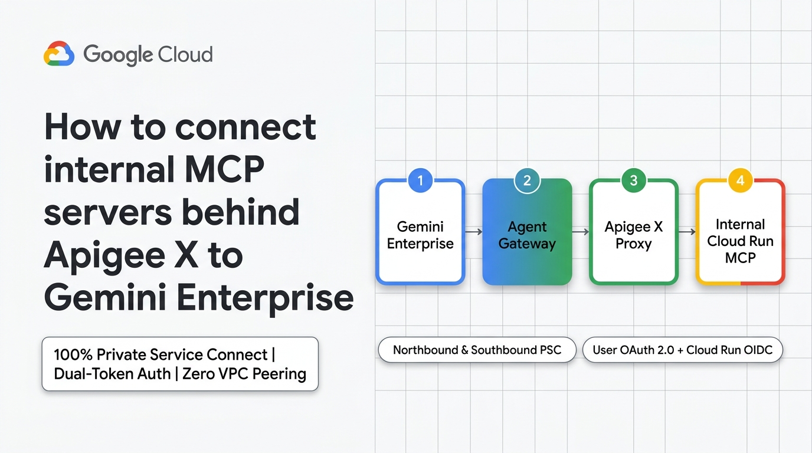
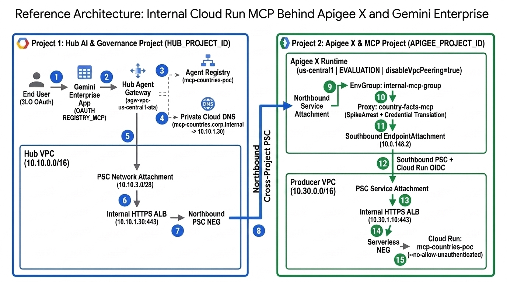
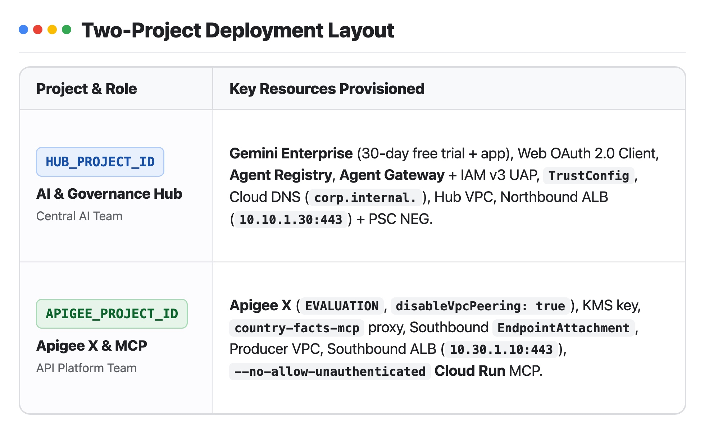

# Internal Cloud Run MCP Servers Behind Apigee X + Private Service Connect + Agent Gateway + Gemini Enterprise



Complete reference implementation and automation suite for connecting an **internal-only, `--no-allow-unauthenticated` Cloud Run Model Context Protocol (MCP) server** hosted in a dedicated API project to **Gemini Enterprise** in an AI hub project — routed **100% privately** over **Agent Gateway**, **Northbound & Southbound Private Service Connect (PSC)**, and **Apigee X (`EVALUATION` mode, `disableVpcPeering: true`)**.

---

## End-to-End Architecture (15-Hop Private Flow)



### Key Enterprise Capabilities
- **Zero Public Internet & Zero VPC Peering:** Public `*.run.app` access returns `HTTP 404`. Traffic traverses Hub Agent Gateway -> Hub Internal HTTPS ALB (`10.10.1.30:443`) -> Northbound PSC NEG -> Apigee X -> Southbound `EndpointAttachment` -> Producer Internal HTTPS ALB (`10.30.1.10:443`) -> Cloud Run.
- **Two-Layer Auth via Dual-Credential Translation:** Apigee X preserves the signed-in employee's 3LO Google OAuth 2.0 access token in `X-MCP-User-Authorization` and mints a Google-signed Cloud Run OIDC ID token (`<GoogleIDToken>`) as `sa-apigee-invoker`, keeping Cloud Run's platform IAM invoker check (`--no-allow-unauthenticated`) active alongside end-user OAuth validation.
- **Governed Discovery & Traffic Protection:** Hub Agent Registry + IAM v3 Universal Access Policies (`destination.is_registered == true`) govern outbound AI egress while Apigee X enforces `SpikeArrest` (`30ps`) rate limiting.



---

## Quickstart: Choose Your Deployment Path

### Prerequisites
- `gcloud` (500.0.0+), `curl`, `jq`, `openssl`, `zip`, and `python3` installed (or run directly in Google Cloud Shell).
- Active Google Cloud billing account + **Owner/Editor-equivalent permissions** in your organization (**Project Creator**, **Billing Account User**, and **Organization Policy Administrator**, since `./deploy.sh` creates two projects, links billing, grants IAM roles, and relaxes project-level org policy constraints if enforced).

Clone this repository first:

```bash
git clone https://github.com/caugusto/blog_ge_apigee_mcp.git
cd blog_ge_apigee_mcp
```

---

### Path A: Automated Provisioner from Blank Projects (`./deploy.sh`)

`./deploy.sh` is an interactive, idempotent provisioner that assumes **nothing exists yet**. It prompts for your billing account ID, two project IDs, and region, creates both projects, enables all APIs, guides you through the one-time 60-second Console step to create a Web OAuth 2.0 client (`*.apps.googleusercontent.com`), and then automatically provisions:
1. A **30-day Gemini Enterprise free trial license** (`free_trial_gemini`), `default_user_store` seat auto-registration, and your **Gemini Enterprise intranet app**.
2. Enterprise Private Root CA (`certs/ca.crt`), Hub VPC, Private Cloud DNS, Certificate Manager `TrustConfig`, and **Hub Agent Gateway** + IAM v3 UAP.
3. The internal `--no-allow-unauthenticated` **Country Facts FastMCP server** on Cloud Run.
4. **Apigee X (`EVALUATION` mode)**, Cloud KMS CMEK key, runtime instance, Southbound & Northbound PSC attachments, **two-pass `EA_HOST` SAN TLS certificates**, `country-facts-mcp` proxy bundle, Agent Registry entry, Gemini Enterprise `REGISTRY_MCP` connector, and an in-VPC verification job.

```bash
chmod +x deploy.sh verify.sh teardown.sh
./deploy.sh
tail -f deploy.log
# Collects initial prompts + OAuth client once, then detaches Stages 3-10 into the background by default (~45-55 min end-to-end on blank projects; logs in deploy.log).
# Safe to re-run anytime: checks every API, IAM binding, Cloud Run service, Apigee component, ALB, and connector first and [SKIP]s anything already configured.
# Optional flags: --foreground | --reconfigure | --rebuild-mcp | --redeploy-proxy
```

Re-run verification anytime with:

```bash
./verify.sh
```

---

### Path B: Step-by-Step Manual CLI Deployment

If you prefer to execute and inspect each `gcloud`, `openssl`, and `curl` command individually across all nine phases, follow **[`docs/MANUAL_DEPLOYMENT_GUIDE.md`](./docs/MANUAL_DEPLOYMENT_GUIDE.md)**.

---

## Teardown / Cost Control

When you finish testing, delete the Apigee `EVALUATION` organization and both Google Cloud projects in one command (or pass `--keep-projects` to delete only the resources inside them):

```bash
./teardown.sh
# Optional: pass --keep-projects to remove inner resources while keeping both project shells:
# ./teardown.sh --keep-projects
```

---

## Repository Structure

```text
.
├── deploy.sh                         # Path A: Interactive, idempotent end-to-end provisioner
├── verify.sh                         # Public 404 check + in-VPC Cloud Run verifier + chat URL
├── teardown.sh                       # Clean removal of evaluation resources (or full projects)
├── .env.example                      # Optional pre-filled configuration template
├── docs/
│   └── MANUAL_DEPLOYMENT_GUIDE.md    # Path B: Complete 9-phase manual CLI guide
├── mcp_countries_server/             # FastMCP StreamableHTTP server + GoogleOAuth2Middleware
├── apigee_bundles/country-facts-mcp/ # Apigee X proxy bundle (SpikeArrest + Token Translation + OIDC)
├── cfg/toolspec_countries.json       # Agent Registry MCP ToolSpec
├── verifier_job/                     # Standalone in-VPC Cloud Run verification job
└── images/                           # Architecture, sequence, TLS, and comparison diagrams
```
