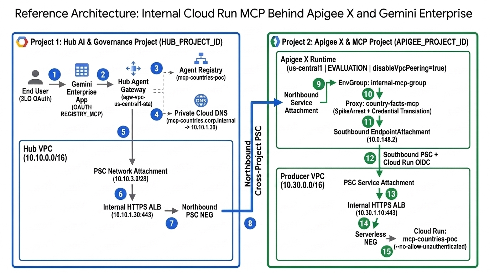

# Manual Step-by-Step Deployment Guide (Path B)

This runbook guides you through provisioning the entire two-project **Internal Cloud Run MCP Behind Apigee X + Dual Private Service Connect + Agent Gateway + Gemini Enterprise** architecture manually from the command line, phase by phase.

> **Prefer one-command automation?** Return to the root [`README.md`](../README.md) and run `./deploy.sh --background` (**Path A**), which automates all steps below from blank Google Cloud projects with detached background logging (`deploy.log`) and check-before-act `[SKIP]` resume.

---

## Architecture Reference (15-Hop Private Flow)



---

## Prerequisites

- **Workstation or Cloud Shell tools:** `gcloud` (500.0.0+), `curl`, `jq`, `openssl`, `zip`, and `python3`.
- **Google Cloud permissions:** Billing Account User + Project Creator (or Owner / IAM Admin + Network Admin + Apigee Org Admin + Discovery Engine Admin on two blank projects).
- Run all commands below from the root of your cloned `blog_ge_apigee_mcp` repository so `mcp_countries_server/`, `apigee_bundles/`, `cfg/`, and `verifier_job/` are in your working directory.

---

## Phase 1: Create projects, link billing, and enable APIs

Sign in to Google Cloud, export your environment variables, create both projects (skip `gcloud projects create` if reusing existing projects), and enable all required APIs and service accounts:

```bash
gcloud auth login
gcloud auth application-default login

export BILLING_ACCOUNT_ID="PASTE_YOUR_BILLING_ACCOUNT_ID"   # e.g., 012345-6789AB-CDEF01
export HUB_PROJECT_ID="ge-mcp-hub-$(date +%s | tail -c 5)"
export APIGEE_PROJECT_ID="apigee-mcp-$(date +%s | tail -c 5)"
export REGION="us-central1"
export GE_LOCATION="global"
export GE_APP_ID="ge-apigee-mcp-app"
export COMPANY_NAME="Enterprise AI"

export COUNTRIES_HOST="mcp-countries.corp.internal"
export COUNTRIES_MCP_URL="https://${COUNTRIES_HOST}/mcp"
export HUB_APIGEE_ILB_IP="10.10.1.30"
export SB_ILB_IP="10.30.1.10"

get_token() {
  gcloud auth print-access-token
}

mkdir -p certs cfg

# Create both projects and link billing (skip creation if using pre-created projects)
for PROJ in "${HUB_PROJECT_ID}" "${APIGEE_PROJECT_ID}"; do
  gcloud projects create "${PROJ}"
  gcloud billing projects link "${PROJ}" --billing-account="${BILLING_ACCOUNT_ID}"
done

export HUB_PROJECT_NUMBER=$(gcloud projects describe "${HUB_PROJECT_ID}" --format="value(projectNumber)")
export APIGEE_PROJECT_NUMBER=$(gcloud projects describe "${APIGEE_PROJECT_ID}" --format="value(projectNumber)")
export ORG_ID=$(gcloud projects get-ancestors "${HUB_PROJECT_ID}" --format=json | jq -r '[.[] | select(.type=="organization") | .id][0] // empty')

if [[ -n "${ORG_ID}" ]]; then
  export TRUST_DOMAIN="agents.global.org-${ORG_ID}.system.id.goog"
else
  export TRUST_DOMAIN="agents.global.proj-${HUB_PROJECT_NUMBER}.system.id.goog"
fi
```

Enable the required APIs across both projects and create the least-privilege service accounts:

```bash
# Enable APIs on HUB_PROJECT_ID (in two batches <= 20 to satisfy Service Usage batch limits)
gcloud services enable \
  serviceusage.googleapis.com \
  cloudresourcemanager.googleapis.com \
  discoveryengine.googleapis.com \
  networkservices.googleapis.com \
  networksecurity.googleapis.com \
  serviceextensions.googleapis.com \
  iap.googleapis.com \
  agentregistry.googleapis.com \
  agentidentity.googleapis.com \
  agentidentitycredentials.googleapis.com \
  aiplatform.googleapis.com \
  compute.googleapis.com \
  --project="${HUB_PROJECT_ID}"

gcloud services enable \
  dns.googleapis.com \
  certificatemanager.googleapis.com \
  run.googleapis.com \
  cloudbuild.googleapis.com \
  artifactregistry.googleapis.com \
  storage.googleapis.com \
  orgpolicy.googleapis.com \
  iam.googleapis.com \
  iamcredentials.googleapis.com \
  logging.googleapis.com \
  --project="${HUB_PROJECT_ID}"

# Ensure custom MCP connectors and IAM v3 UAP bindings are allowed on HUB_PROJECT_ID
if [[ -n "${ORG_ID}" ]]; then
  for CONSTRAINT in \
    discoveryengine.managed.disableCustomMcpServerConnector \
    iam.managed.disableAccessPolicyBinding; do
    cat > "cfg/policy_${CONSTRAINT}.yaml" <<EOF
name: projects/${HUB_PROJECT_NUMBER}/policies/${CONSTRAINT}
spec:
  rules:
  - enforce: false
EOF
    gcloud org-policies set-policy "cfg/policy_${CONSTRAINT}.yaml" --project="${HUB_PROJECT_ID}" || true
  done
fi

# Enable APIs & create service agents on APIGEE_PROJECT_ID
gcloud services enable \
  serviceusage.googleapis.com \
  cloudresourcemanager.googleapis.com \
  apigee.googleapis.com \
  compute.googleapis.com \
  run.googleapis.com \
  cloudkms.googleapis.com \
  cloudbuild.googleapis.com \
  artifactregistry.googleapis.com \
  storage.googleapis.com \
  iam.googleapis.com \
  iamcredentials.googleapis.com \
  logging.googleapis.com \
  --project="${APIGEE_PROJECT_ID}"

for SVC in apigee.googleapis.com cloudkms.googleapis.com compute.googleapis.com cloudbuild.googleapis.com; do
  gcloud beta services identity create --service="${SVC}" --project="${APIGEE_PROJECT_ID}"
done
for SVC in networkservices.googleapis.com discoveryengine.googleapis.com compute.googleapis.com cloudbuild.googleapis.com; do
  gcloud beta services identity create --service="${SVC}" --project="${HUB_PROJECT_ID}"
done

gcloud projects add-iam-policy-binding "${HUB_PROJECT_ID}" \
  --member="serviceAccount:service-${HUB_PROJECT_NUMBER}@gcp-sa-discoveryengine.iam.gserviceaccount.com" \
  --role="roles/discoveryengine.serviceAgent" --condition=None --quiet >/dev/null

# Grant Cloud Build source-deploy roles to Default Compute SAs on blank projects
for PAIR in "${HUB_PROJECT_ID}:${HUB_PROJECT_NUMBER}" "${APIGEE_PROJECT_ID}:${APIGEE_PROJECT_NUMBER}"; do
  IFS=":" read -r P_ID P_NUM <<< "${PAIR}"
  for BUILD_ROLE in roles/storage.admin roles/artifactregistry.writer roles/logging.logWriter roles/cloudbuild.builds.builder; do
    gcloud projects add-iam-policy-binding "${P_ID}" \
      --member="serviceAccount:${P_NUM}-compute@developer.gserviceaccount.com" \
      --role="${BUILD_ROLE}" --condition=None --quiet >/dev/null || true
  done
done

export APIGEE_SERVICE_AGENT="service-${APIGEE_PROJECT_NUMBER}@gcp-sa-apigee.iam.gserviceaccount.com"

# Create least-privilege service accounts
gcloud iam service-accounts create sa-mcp-countries \
  --display-name="Country Facts Internal MCP Runtime SA" \
  --project="${APIGEE_PROJECT_ID}"

gcloud iam service-accounts create sa-apigee-invoker \
  --display-name="Apigee X Southbound Cloud Run Invoker SA" \
  --project="${APIGEE_PROJECT_ID}"

gcloud iam service-accounts create sa-mcp-verifier \
  --display-name="In-VPC MCP Verifier SA" \
  --project="${HUB_PROJECT_ID}"

for ROLE in roles/iam.serviceAccountUser roles/iam.serviceAccountTokenCreator; do
  gcloud iam service-accounts add-iam-policy-binding \
    "sa-apigee-invoker@${APIGEE_PROJECT_ID}.iam.gserviceaccount.com" \
    --member="serviceAccount:${APIGEE_SERVICE_AGENT}" \
    --role="${ROLE}" \
    --project="${APIGEE_PROJECT_ID}"
done
```

---

## Phase 2: Create Web OAuth 2.0 client & provision Gemini Enterprise (with 30-day trial)

### 2.1 Create the Google Auth Platform Web OAuth 2.0 client (60-second Console step)

Google Cloud restricts 3LO Web OAuth 2.0 client creation (`*.apps.googleusercontent.com`) to the Cloud Console for anti-phishing security:

1. Open `https://console.cloud.google.com/auth/clients?project=${HUB_PROJECT_ID}`.
2. **Configure the OAuth consent screen first (required on a new project):** Click **Get started**, enter an **App name** and **User support email**, select Audience **Internal**, enter a **Contact Information** email, check the policy box, and click **Create**.
3. **Navigate to Clients:** In the left-hand navigation menu, click **Clients**, then click **+ Create client** at the top.
4. Select Application type **Web application** (and enter any client name).
5. Under **Authorized redirect URIs**, click **+ Add URI** and paste:
   ```text
   https://vertexaisearch.cloud.google.com/oauth-redirect
   ```
6. Click **Create**, copy the **Client ID** and **Client secret** from the **OAuth client created** dialog, and export them:

```bash
export OAUTH_CLIENT_ID="PASTE_YOUR_OAUTH_CLIENT_ID.apps.googleusercontent.com"
export OAUTH_CLIENT_SECRET="PASTE_YOUR_OAUTH_CLIENT_SECRET"
```

### 2.2 Configure Cloud Identity (`global`), 30-day free trial license & intranet app via API

```bash
# 1. Assign Google Identity / Cloud Identity (GSUITE) as the Identity Provider in the global location
curl -s -X PATCH \
  "https://${GE_LOCATION}-discoveryengine.googleapis.com/v1alpha/projects/${HUB_PROJECT_ID}/locations/${GE_LOCATION}/aclConfig" \
  -H "Authorization: Bearer $(get_token)" \
  -H "X-Goog-User-Project: ${HUB_PROJECT_ID}" \
  -H "Content-Type: application/json" \
  -d "{
    \"name\": \"projects/${HUB_PROJECT_ID}/locations/${GE_LOCATION}/aclConfig\",
    \"idpConfig\": {\"idpType\": \"GSUITE\"}
  }" | jq .

# 2. Provision a 50-seat 30-day Gemini Enterprise free trial license & auto-assign seats
read -r YEAR MONTH DAY <<< "$(python3 -c 'from datetime import datetime, timezone, timedelta; d = datetime.now(timezone.utc) + timedelta(days=1); print(d.year, d.month, d.day)')"

TRIAL_RESP=$(curl -s -X POST \
  "https://${GE_LOCATION}-discoveryengine.googleapis.com/v1alpha/projects/${HUB_PROJECT_ID}/locations/${GE_LOCATION}/licenseConfigs?licenseConfigId=free_trial_gemini" \
  -H "Authorization: Bearer $(get_token)" \
  -H "X-Goog-User-Project: ${HUB_PROJECT_ID}" \
  -H "Content-Type: application/json" \
  -d "{
    \"licenseCount\": \"50\",
    \"subscriptionTier\": \"SUBSCRIPTION_TIER_SEARCH_AND_ASSISTANT\",
    \"startDate\": {\"year\": ${YEAR}, \"month\": ${MONTH}, \"day\": ${DAY}},
    \"subscriptionTerm\": \"SUBSCRIPTION_TERM_ONE_MONTH\",
    \"freeTrial\": true
  }")

LIC_NAME=$(echo "${TRIAL_RESP}" | jq -r '.name // empty')
if [[ -n "${LIC_NAME}" ]]; then
  curl -s -X PATCH \
    "https://${GE_LOCATION}-discoveryengine.googleapis.com/v1alpha/projects/${HUB_PROJECT_ID}/locations/${GE_LOCATION}/userStores/default_user_store?updateMask=defaultLicenseConfig,enableLicenseAutoRegister" \
    -H "Authorization: Bearer $(get_token)" \
    -H "X-Goog-User-Project: ${HUB_PROJECT_ID}" \
    -H "Content-Type: application/json" \
    -d "{
      \"defaultLicenseConfig\": \"${LIC_NAME}\",
      \"enableLicenseAutoRegister\": true
    }" | jq .
fi

# 3. Create initial Discovery Engine DataStore (required by CreateEngineRequest on blank projects)
curl -s -X POST \
  "https://${GE_LOCATION}-discoveryengine.googleapis.com/v1alpha/projects/${HUB_PROJECT_NUMBER}/locations/${GE_LOCATION}/collections/default_collection/dataStores?dataStoreId=ge-init-store" \
  -H "Authorization: Bearer $(get_token)" \
  -H "X-Goog-User-Project: ${HUB_PROJECT_ID}" \
  -H "Content-Type: application/json" \
  -d '{
    "displayName": "Gemini Enterprise Initial Store",
    "industryVertical": "GENERIC",
    "solutionTypes": ["SOLUTION_TYPE_SEARCH"],
    "contentConfig": "CONTENT_REQUIRED"
  }' | jq .

while [[ "$(curl -s -o /dev/null -w '%{http_code}' -H "Authorization: Bearer $(get_token)" -H "X-Goog-User-Project: ${HUB_PROJECT_ID}" "https://${GE_LOCATION}-discoveryengine.googleapis.com/v1alpha/projects/${HUB_PROJECT_NUMBER}/locations/${GE_LOCATION}/collections/default_collection/dataStores/ge-init-store")" != "200" ]]; do
  sleep 4
done

# 3. Create Gemini Enterprise intranet app (${GE_APP_ID})
curl -s -X POST \
  "https://${GE_LOCATION}-discoveryengine.googleapis.com/v1alpha/projects/${HUB_PROJECT_NUMBER}/locations/${GE_LOCATION}/collections/default_collection/engines?engineId=${GE_APP_ID}" \
  -H "Authorization: Bearer $(get_token)" \
  -H "X-Goog-User-Project: ${HUB_PROJECT_ID}" \
  -H "Content-Type: application/json" \
  -d "{
    \"displayName\": \"${GE_APP_ID}\",
    \"solutionType\": \"SOLUTION_TYPE_SEARCH\",
    \"industryVertical\": \"GENERIC\",
    \"appType\": \"APP_TYPE_INTRANET\",
    \"searchEngineConfig\": {
      \"searchTier\": \"SEARCH_TIER_ENTERPRISE\",
      \"searchAddOns\": [\"SEARCH_ADD_ON_LLM\"]
    },
    \"commonConfig\": {\"companyName\": \"${COMPANY_NAME}\"},
    \"dataStoreIds\": [\"ge-init-store\"]
  }" | jq .

while [[ "$(curl -s -o /dev/null -w '%{http_code}' -H "Authorization: Bearer $(get_token)" -H "X-Goog-User-Project: ${HUB_PROJECT_ID}" "https://${GE_LOCATION}-discoveryengine.googleapis.com/v1alpha/projects/${HUB_PROJECT_NUMBER}/locations/${GE_LOCATION}/collections/default_collection/engines/${GE_APP_ID}")" != "200" ]]; do
  sleep 5
done
```

---

## Phase 3: Build hub VPC, Private PKI, and Agent Gateway

Generate the Enterprise Private Root CA (`certs/ca.crt`), register `tc-mcp-corp-internal` in Certificate Manager, build `vpc-mcp-internal` (`10.10.0.0/16`) and Private DNS (`zone-corp-internal`), deploy Hub Agent Gateway (`agw-vpc-us-central1-ata`) with IAM v3 UAP governance, and bind it to `${GE_APP_ID}`:

```bash
# 1. Generate Enterprise Private Root CA & Certificate Manager TrustConfig
openssl req -x509 -newkey rsa:2048 -nodes -days 3650 \
  -keyout certs/ca.key -out certs/ca.crt \
  -subj "/O=Enterprise Internal PKI/CN=MCP Internal Root CA" \
  -addext "basicConstraints=critical,CA:TRUE" \
  -addext "keyUsage=critical,keyCertSign,cRLSign"

gcloud certificate-manager trust-configs create tc-mcp-corp-internal \
  --location="${REGION}" \
  --trust-store="trust-anchors=certs/ca.crt" \
  --project="${HUB_PROJECT_ID}"

# 2. Create Hub VPC, Subnets, Agent Gateway PSC Network Attachment & Private DNS Zone
gcloud compute networks create vpc-mcp-internal --subnet-mode=custom --project="${HUB_PROJECT_ID}"

gcloud compute networks subnets create subnet-ilb-backend \
  --network=vpc-mcp-internal --region="${REGION}" --range=10.10.1.0/24 \
  --enable-private-ip-google-access --project="${HUB_PROJECT_ID}"

gcloud compute networks subnets create subnet-ilb-proxy \
  --network=vpc-mcp-internal --region="${REGION}" --range=10.10.2.0/24 \
  --purpose=REGIONAL_MANAGED_PROXY --role=ACTIVE --project="${HUB_PROJECT_ID}"

gcloud compute networks subnets create subnet-agw-psc \
  --network=vpc-mcp-internal --region="${REGION}" --range=10.10.3.0/28 \
  --enable-private-ip-google-access --project="${HUB_PROJECT_ID}"

gcloud compute network-attachments create na-agw-mcp-internal \
  --region="${REGION}" --subnets=subnet-agw-psc \
  --connection-preference=ACCEPT_AUTOMATIC --project="${HUB_PROJECT_ID}"

gcloud dns managed-zones create zone-corp-internal \
  --dns-name="corp.internal." --description="Private DNS zone for internal MCP services" \
  --visibility=private --networks=vpc-mcp-internal --project="${HUB_PROJECT_ID}"

# 3. Grant Agent Gateway Service Agent permissions & wait 60s for IAM propagation
gcloud beta services identity create --service=networkservices.googleapis.com --project="${HUB_PROJECT_ID}"

for ROLE in \
  roles/agentgateway.serviceAgent \
  roles/compute.networkViewer \
  roles/compute.networkAdmin \
  roles/dns.reader \
  roles/certificatemanager.viewer; do
  gcloud projects add-iam-policy-binding "${HUB_PROJECT_ID}" \
    --member="serviceAccount:service-${HUB_PROJECT_NUMBER}@gcp-sa-agentgateway.iam.gserviceaccount.com" \
    --role="${ROLE}" --condition=None --quiet >/dev/null
done

sleep 60

# 4. Create AgentConnectivityTemplate & AgentGateway
export PSC_NA_URI="projects/${HUB_PROJECT_NUMBER}/regions/${REGION}/networkAttachments/na-agw-mcp-internal"
export TRUST_CONFIG_URI="projects/${HUB_PROJECT_NUMBER}/locations/${REGION}/trustConfigs/tc-mcp-corp-internal"
export ACT_URI="projects/${HUB_PROJECT_NUMBER}/locations/${REGION}/agentConnectivityTemplates/act-vpc-mcp-internal"
export AGW_NAME="agw-vpc-${REGION}-ata"
export AGW_URI="projects/${HUB_PROJECT_ID}/locations/${REGION}/agentGateways/${AGW_NAME}"

ACT_OP=$(curl -s -X POST \
  "https://networkservices.googleapis.com/v1/projects/${HUB_PROJECT_ID}/locations/${REGION}/agentConnectivityTemplates?agentConnectivityTemplateId=act-vpc-mcp-internal" \
  -H "Authorization: Bearer $(get_token)" \
  -H "X-Goog-User-Project: ${HUB_PROJECT_ID}" \
  -H "Content-Type: application/json" \
  -d "{
    \"accessPath\": \"AGENT_TO_ANYWHERE\",
    \"deploymentModel\": \"CENTRALIZED\",
    \"egressNetworkConfig\": {
      \"networkAttachment\": \"${PSC_NA_URI}\",
      \"dnsPeeringConfig\": {
        \"domains\": [\"corp.internal.\"],
        \"targetNetwork\": \"projects/${HUB_PROJECT_ID}/global/networks/vpc-mcp-internal\"
      },
      \"vpcEgress\": \"PRIVATE_RANGES_ONLY\",
      \"tlsConfig\": {
        \"trustConfig\": \"${TRUST_CONFIG_URI}\",
        \"additionalRoots\": \"PUBLICLY_TRUSTED_ROOTS\"
      }
    }
  }" | jq -r '.name')

while [[ "$(curl -s -H "Authorization: Bearer $(get_token)" -H "X-Goog-User-Project: ${HUB_PROJECT_ID}" "https://networkservices.googleapis.com/v1/${ACT_OP}" | jq -r '.done // false')" != "true" ]]; do
  sleep 5
done

AGW_OP=$(curl -s -X POST \
  "https://networkservices.googleapis.com/v1/projects/${HUB_PROJECT_ID}/locations/${REGION}/agentGateways?agentGatewayId=${AGW_NAME}" \
  -H "Authorization: Bearer $(get_token)" \
  -H "X-Goog-User-Project: ${HUB_PROJECT_ID}" \
  -H "Content-Type: application/json" \
  -d "{
    \"protocols\": [\"MCP\"],
    \"googleManaged\": {\"governedAccessPath\": \"AGENT_TO_ANYWHERE\"},
    \"agentConnectivityTemplate\": \"${ACT_URI}\",
    \"registries\": [\"//agentregistry.googleapis.com/projects/${HUB_PROJECT_ID}/locations/${REGION}\"]
  }" | jq -r '.name')

while [[ "$(curl -s -H "Authorization: Bearer $(get_token)" -H "X-Goog-User-Project: ${HUB_PROJECT_ID}" "https://networkservices.googleapis.com/v1/${AGW_OP}" | jq -r '.done // false')" != "true" ]]; do
  sleep 10
done

# 5. Attach IAP v2 AuthzExtension, AuthzPolicy, IAM v3 UAP & bind to Gemini Enterprise
cat > cfg/iap-authz-ext.yaml <<EOF
name: agw-authz-ext-iap-v2
service: iap.googleapis.com
failOpen: false
timeout: 1s
metadata:
  iapPolicyVersion: "V2"
EOF

gcloud service-extensions authz-extensions import agw-authz-ext-iap-v2 \
  --source=cfg/iap-authz-ext.yaml --location="${REGION}" --project="${HUB_PROJECT_ID}"

AUTHZ_OP=$(curl -s -X POST \
  "https://networksecurity.googleapis.com/v1alpha1/projects/${HUB_PROJECT_ID}/locations/${REGION}/authzPolicies?authz_policy_id=${AGW_NAME}-authz-policy-iap" \
  -H "Authorization: Bearer $(get_token)" \
  -H "X-Goog-User-Project: ${HUB_PROJECT_ID}" \
  -H "Content-Type: application/json" \
  -d "{
    \"name\": \"${AGW_NAME}-authz-policy-iap\",
    \"policyProfile\": \"REQUEST_AUTHZ\",
    \"action\": \"CUSTOM\",
    \"target\": {\"resources\": [\"${AGW_URI}\"]},
    \"customProvider\": {
      \"authzExtension\": {
        \"resources\": [\"projects/${HUB_PROJECT_ID}/locations/${REGION}/authzExtensions/agw-authz-ext-iap-v2\"]
      }
    }
  }" | jq -r '.name')

while [[ "$(curl -s -H "Authorization: Bearer $(get_token)" -H "X-Goog-User-Project: ${HUB_PROJECT_ID}" "https://networksecurity.googleapis.com/v1alpha1/${AUTHZ_OP}" | jq -r '.done // false')" != "true" ]]; do
  sleep 5
done

cat > cfg/uap-allow-registered.json <<EOF
[
  {
    "description": "Allow agent egress to Google APIs and registered Agent Registry services",
    "effect": "ALLOW",
    "principals": ["principalSet://${TRUST_DOMAIN}/*"],
    "operation": {"permissions": ["iap.googleapis.com/resources.egressViaIAP"]},
    "conditions": {
      "iap.googleapis.com": {
        "expression": "destination.unregistered.host.endsWith('googleapis.com') || destination.is_registered == true"
      }
    }
  }
]
EOF

gcloud iam access-policies create agent-gateway-allow-policy \
  --details-rules=cfg/uap-allow-registered.json --project="${HUB_PROJECT_ID}" --location=global

# IAM v3 AccessPolicy takes ~5-15s to propagate globally before PolicyBinding can reference it:
until gcloud iam policy-bindings create agent-gateway-allow-binding \
  --policy="projects/${HUB_PROJECT_ID}/locations/global/accessPolicies/agent-gateway-allow-policy" \
  --target-resource="//cloudresourcemanager.googleapis.com/projects/${HUB_PROJECT_ID}" \
  --project="${HUB_PROJECT_ID}" --location=global; do
  echo "Waiting 10s for IAM v3 AccessPolicy propagation..."
  sleep 10
done

curl -s -X PATCH \
  "https://${GE_LOCATION}-discoveryengine.googleapis.com/v1/projects/${HUB_PROJECT_ID}/locations/${GE_LOCATION}/collections/default_collection/engines/${GE_APP_ID}?updateMask=agentGatewaySetting.defaultEgressAgentGateway.name" \
  -H "Authorization: Bearer $(get_token)" \
  -H "X-Goog-User-Project: ${HUB_PROJECT_ID}" \
  -H "Content-Type: application/json" \
  -d "{\"agentGatewaySetting\": {\"defaultEgressAgentGateway\": {\"name\": \"projects/${HUB_PROJECT_NUMBER}/locations/${REGION}/agentGateways/${AGW_NAME}\"}}}" | jq .
```

---

## Phase 4: Deploy the `--no-allow-unauthenticated` Cloud Run MCP server

Deploy [`mcp_countries_server/`](../mcp_countries_server) to `APIGEE_PROJECT_ID` and grant `roles/run.invoker` exclusively to `sa-apigee-invoker`:

```bash
gcloud run deploy mcp-countries-poc \
  --source=mcp_countries_server \
  --region="${REGION}" \
  --project="${APIGEE_PROJECT_ID}" \
  --service-account="sa-mcp-countries@${APIGEE_PROJECT_ID}.iam.gserviceaccount.com" \
  --ingress=internal-and-cloud-load-balancing \
  --no-allow-unauthenticated \
  --port=8080 \
  --min-instances=0 \
  --max-instances=5 \
  --set-env-vars="GOOGLE_CLOUD_PROJECT=${APIGEE_PROJECT_ID},EXPECTED_OAUTH_CLIENT_ID=${OAUTH_CLIENT_ID}"

gcloud run services add-iam-policy-binding mcp-countries-poc \
  --region="${REGION}" \
  --project="${APIGEE_PROJECT_ID}" \
  --member="serviceAccount:sa-apigee-invoker@${APIGEE_PROJECT_ID}.iam.gserviceaccount.com" \
  --role="roles/run.invoker"

export CLOUD_RUN_URL=$(gcloud run services describe mcp-countries-poc \
  --region="${REGION}" --project="${APIGEE_PROJECT_ID}" --format="value(status.url)")
echo "CLOUD_RUN_URL=${CLOUD_RUN_URL}"
```

---

## Phase 5: Provision Apigee X in `EVALUATION` mode (`disableVpcPeering: true`)

> **Timing note:** Provisioning a new single-tenant Apigee X runtime instance takes ~20–25 minutes.

```bash
gcloud kms keyrings create "apigee-keyring-${REGION}" --location="${REGION}" --project="${APIGEE_PROJECT_ID}"
gcloud kms keys create apigee-disk-key --keyring="apigee-keyring-${REGION}" --location="${REGION}" --purpose=encryption --project="${APIGEE_PROJECT_ID}"
export KMS_KEY_ID="projects/${APIGEE_PROJECT_ID}/locations/${REGION}/keyRings/apigee-keyring-${REGION}/cryptoKeys/apigee-disk-key"

gcloud kms keys add-iam-policy-binding apigee-disk-key \
  --keyring="apigee-keyring-${REGION}" --location="${REGION}" \
  --member="serviceAccount:${APIGEE_SERVICE_AGENT}" \
  --role="roles/cloudkms.cryptoKeyEncrypterDecrypter" \
  --project="${APIGEE_PROJECT_ID}"

OP_ORG=$(curl -s -X POST \
  "https://apigee.googleapis.com/v1/organizations?parent=projects/${APIGEE_PROJECT_ID}" \
  -H "Authorization: Bearer $(get_token)" -H "Content-Type: application/json" \
  -d "{
    \"name\": \"${APIGEE_PROJECT_ID}\",
    \"displayName\": \"Apigee X Internal MCP Organization\",
    \"analyticsRegion\": \"${REGION}\",
    \"runtimeType\": \"CLOUD\",
    \"billingType\": \"EVALUATION\",
    \"disableVpcPeering\": true
  }" | jq -r '.name')

while [[ "$(curl -s -H "Authorization: Bearer $(get_token)" "https://apigee.googleapis.com/v1/${OP_ORG}" | jq -r '.done // false')" != "true" ]]; do
  sleep 10
done

# Wait for Apigee's automatic post-org AddonsConfig update lock to settle
wait_apigee_idle() {
  while [[ "$(curl -s -H "Authorization: Bearer $(get_token)" "https://apigee.googleapis.com/v1/organizations/${APIGEE_PROJECT_ID}/operations" | jq -r '[.operations[]? | select(.metadata.state == "IN_PROGRESS")] | length')" != "0" ]]; do
    sleep 5
  done
}
sleep 3 && wait_apigee_idle

OP_ENV=$(curl -s -X POST "https://apigee.googleapis.com/v1/organizations/${APIGEE_PROJECT_ID}/environments" \
  -H "Authorization: Bearer $(get_token)" -H "Content-Type: application/json" \
  -d '{"name": "eval-mcp", "displayName": "Internal MCP Evaluation Env", "deploymentType": "PROXY", "apiProxyType": "PROGRAMMABLE"}' | jq -r '.name')
if [[ "${OP_ENV}" == organizations/*/operations/* ]]; then
  while [[ "$(curl -s -H "Authorization: Bearer $(get_token)" "https://apigee.googleapis.com/v1/${OP_ENV}" | jq -r '.done // false')" != "true" ]]; do sleep 5; done
fi
wait_apigee_idle

OP_EG_CREATE=$(curl -s -X POST "https://apigee.googleapis.com/v1/organizations/${APIGEE_PROJECT_ID}/envgroups" \
  -H "Authorization: Bearer $(get_token)" -H "Content-Type: application/json" \
  -d "{\"name\": \"internal-mcp-group\", \"hostnames\": [\"${COUNTRIES_HOST}\"]}" | jq -r '.name')
if [[ "${OP_EG_CREATE}" == organizations/*/operations/* ]]; then
  while [[ "$(curl -s -H "Authorization: Bearer $(get_token)" "https://apigee.googleapis.com/v1/${OP_EG_CREATE}" | jq -r '.done // false')" != "true" ]]; do sleep 5; done
fi
wait_apigee_idle

OP_EG=$(curl -s -X POST "https://apigee.googleapis.com/v1/organizations/${APIGEE_PROJECT_ID}/envgroups/internal-mcp-group/attachments" \
  -H "Authorization: Bearer $(get_token)" -H "Content-Type: application/json" \
  -d '{"environment": "eval-mcp"}' | jq -r '.name')

while [[ "$(curl -s -H "Authorization: Bearer $(get_token)" "https://apigee.googleapis.com/v1/${OP_EG}" | jq -r '.done // false')" != "true" ]]; do
  sleep 5
done
wait_apigee_idle

OP_INST=$(curl -s -X POST "https://apigee.googleapis.com/v1/organizations/${APIGEE_PROJECT_ID}/instances" \
  -H "Authorization: Bearer $(get_token)" -H "Content-Type: application/json" \
  -d "{
    \"name\": \"apigee-${REGION}\",
    \"location\": \"${REGION}\",
    \"diskEncryptionKeyName\": \"${KMS_KEY_ID}\",
    \"consumerAcceptList\": [\"${HUB_PROJECT_ID}\", \"${APIGEE_PROJECT_ID}\"]
  }" | jq -r '.name')

echo "Waiting ~20-25 minutes for Apigee Runtime Instance (${OP_INST})..."
while [[ "$(curl -s -H "Authorization: Bearer $(get_token)" "https://apigee.googleapis.com/v1/${OP_INST}" | jq -r '.done // false')" != "true" ]]; do
  sleep 30
done

OP_ATT=$(curl -s -X POST "https://apigee.googleapis.com/v1/organizations/${APIGEE_PROJECT_ID}/instances/apigee-${REGION}/attachments" \
  -H "Authorization: Bearer $(get_token)" -H "Content-Type: application/json" \
  -d '{"environment": "eval-mcp"}' | jq -r '.name')

while [[ "$(curl -s -H "Authorization: Bearer $(get_token)" "https://apigee.googleapis.com/v1/${OP_ATT}" | jq -r '.done // false')" != "true" ]]; do
  sleep 10
done

export APIGEE_NB_SERVICE_ATTACHMENT=$(curl -s -H "Authorization: Bearer $(get_token)" \
  "https://apigee.googleapis.com/v1/organizations/${APIGEE_PROJECT_ID}/instances/apigee-${REGION}" | jq -r '.serviceAttachment')

curl -s -X POST "https://apigee.googleapis.com/v1/organizations/${APIGEE_PROJECT_ID}/environments/eval-mcp/keystores" \
  -H "Authorization: Bearer $(get_token)" -H "Content-Type: application/json" -d '{"name": "mcp-ca-truststore"}'

curl -s -X POST "https://apigee.googleapis.com/v1/organizations/${APIGEE_PROJECT_ID}/environments/eval-mcp/keystores/mcp-ca-truststore/aliases?alias=mcp-root-ca&format=keycertfile" \
  -H "Authorization: Bearer $(get_token)" -F "file=@certs/ca.crt"

curl -s -X POST "https://apigee.googleapis.com/v1/organizations/${APIGEE_PROJECT_ID}/environments/eval-mcp/references" \
  -H "Authorization: Bearer $(get_token)" -H "Content-Type: application/json" \
  -d '{"name": "mcp-ca-truststore-ref", "resourceType": "KeyStore", "refers": "mcp-ca-truststore"}'
```

---

## Phase 6: Wire southbound PSC and two-pass `EA_HOST` SAN TLS

```bash
gcloud compute networks create vpc-apigee-mcp --subnet-mode=custom --project="${APIGEE_PROJECT_ID}"

gcloud compute networks subnets create subnet-apigee-mcp-backend \
  --network=vpc-apigee-mcp --region="${REGION}" --range=10.30.1.0/24 \
  --enable-private-ip-google-access --project="${APIGEE_PROJECT_ID}"

gcloud compute networks subnets create subnet-apigee-mcp-proxy \
  --network=vpc-apigee-mcp --region="${REGION}" --purpose=REGIONAL_MANAGED_PROXY \
  --role=ACTIVE --range=10.30.2.0/24 --project="${APIGEE_PROJECT_ID}"

gcloud compute networks subnets create subnet-apigee-mcp-psc-nat \
  --network=vpc-apigee-mcp --region="${REGION}" --purpose=PRIVATE_SERVICE_CONNECT \
  --range=10.30.3.0/24 --project="${APIGEE_PROJECT_ID}"

gcloud compute addresses create ip-ilb-mcp-countries \
  --region="${REGION}" --subnet=subnet-apigee-mcp-backend \
  --addresses="${SB_ILB_IP}" --project="${APIGEE_PROJECT_ID}"

# Pass 1: Bootstrap Southbound ALB certificate
openssl genrsa -out certs/mcp-countries-sb.key 2048
cat > certs/countries-sb-init.cnf <<EOF
[req]
distinguished_name = dn
req_extensions = v3_req
prompt = no
[dn]
CN = ${COUNTRIES_HOST}
[v3_req]
basicConstraints = CA:FALSE
keyUsage = critical, digitalSignature, keyEncipherment
extendedKeyUsage = serverAuth
subjectAltName = DNS:${COUNTRIES_HOST},IP:${SB_ILB_IP},IP:${HUB_APIGEE_ILB_IP}
EOF

openssl req -new -key certs/mcp-countries-sb.key -out certs/mcp-countries-sb.csr -config certs/countries-sb-init.cnf
openssl x509 -req -in certs/mcp-countries-sb.csr -CA certs/ca.crt -CAkey certs/ca.key -CAcreateserial \
  -out certs/mcp-countries-sb-init.crt -days 825 -sha256 -extensions v3_req -extfile certs/countries-sb-init.cnf

gcloud compute ssl-certificates create cert-mcp-countries-sb-v1 \
  --certificate=certs/mcp-countries-sb-init.crt --private-key=certs/mcp-countries-sb.key \
  --region="${REGION}" --project="${APIGEE_PROJECT_ID}"

gcloud compute network-endpoint-groups create neg-mcp-countries-poc \
  --region="${REGION}" --network-endpoint-type=serverless \
  --cloud-run-service=mcp-countries-poc --project="${APIGEE_PROJECT_ID}"

gcloud compute backend-services create bs-mcp-countries-poc \
  --load-balancing-scheme=INTERNAL_MANAGED --protocol=HTTP \
  --region="${REGION}" --project="${APIGEE_PROJECT_ID}"

gcloud compute backend-services add-backend bs-mcp-countries-poc \
  --region="${REGION}" --network-endpoint-group=neg-mcp-countries-poc \
  --network-endpoint-group-region="${REGION}" --project="${APIGEE_PROJECT_ID}"

gcloud compute url-maps create um-mcp-countries-poc \
  --default-service=bs-mcp-countries-poc --region="${REGION}" --project="${APIGEE_PROJECT_ID}"

gcloud compute target-https-proxies create tp-mcp-countries-poc \
  --url-map=um-mcp-countries-poc --ssl-certificates=cert-mcp-countries-sb-v1 \
  --region="${REGION}" --project="${APIGEE_PROJECT_ID}"

gcloud compute forwarding-rules create fr-mcp-countries-poc \
  --load-balancing-scheme=INTERNAL_MANAGED --network=vpc-apigee-mcp \
  --subnet=subnet-apigee-mcp-backend --address=ip-ilb-mcp-countries --ports=443 \
  --region="${REGION}" --target-https-proxy=tp-mcp-countries-poc \
  --target-https-proxy-region="${REGION}" --project="${APIGEE_PROJECT_ID}"

gcloud compute service-attachments create sa-psc-mcp-countries \
  --region="${REGION}" --producer-forwarding-rule=fr-mcp-countries-poc \
  --connection-preference=ACCEPT_AUTOMATIC --nat-subnets=subnet-apigee-mcp-psc-nat \
  --project="${APIGEE_PROJECT_ID}"

export SB_SERVICE_ATTACHMENT="projects/${APIGEE_PROJECT_ID}/regions/${REGION}/serviceAttachments/sa-psc-mcp-countries"

OP_EA=$(curl -s -X POST \
  "https://apigee.googleapis.com/v1/organizations/${APIGEE_PROJECT_ID}/endpointAttachments?endpointAttachmentId=ea-mcp-countries" \
  -H "Authorization: Bearer $(get_token)" -H "Content-Type: application/json" \
  -d "{\"location\": \"${REGION}\", \"serviceAttachment\": \"${SB_SERVICE_ATTACHMENT}\"}" | jq -r '.name')

while [[ "$(curl -s -H "Authorization: Bearer $(get_token)" "https://apigee.googleapis.com/v1/${OP_EA}" | jq -r '.done // false')" != "true" ]]; do
  sleep 10
done

export EA_HOST=$(curl -s -H "Authorization: Bearer $(get_token)" \
  "https://apigee.googleapis.com/v1/organizations/${APIGEE_PROJECT_ID}/endpointAttachments/ea-mcp-countries" | jq -r '.host')
echo "EA_HOST=${EA_HOST}"

# Pass 2: Re-issue Southbound certificate including IP:${EA_HOST} in SAN
cat > certs/countries-sb-ext.cnf <<EOF
[v3_req]
basicConstraints = CA:FALSE
keyUsage = critical, digitalSignature, keyEncipherment
extendedKeyUsage = serverAuth
subjectAltName = DNS:${COUNTRIES_HOST},IP:${SB_ILB_IP},IP:${HUB_APIGEE_ILB_IP},IP:${EA_HOST}
EOF

openssl x509 -req -in certs/mcp-countries-sb.csr -CA certs/ca.crt -CAkey certs/ca.key -CAcreateserial \
  -out certs/mcp-countries-sb.crt -days 825 -sha256 -extensions v3_req -extfile certs/countries-sb-ext.cnf

gcloud compute ssl-certificates create cert-mcp-countries-sb-v2 \
  --certificate=certs/mcp-countries-sb.crt --private-key=certs/mcp-countries-sb.key \
  --region="${REGION}" --project="${APIGEE_PROJECT_ID}"

gcloud compute target-https-proxies update tp-mcp-countries-poc \
  --ssl-certificates=cert-mcp-countries-sb-v2 --region="${REGION}" --project="${APIGEE_PROJECT_ID}"
```

---

## Phase 7: Render, package, and deploy Apigee proxy `country-facts-mcp`

```bash
sed \
  -e "s|__EA_HOST__|${EA_HOST}|g" \
  -e "s|__CLOUD_RUN_URL__|${CLOUD_RUN_URL}|g" \
  apigee_bundles/country-facts-mcp/apiproxy/targets/default.xml.tmpl \
  > apigee_bundles/country-facts-mcp/apiproxy/targets/default.xml

rm -f country-facts-mcp.zip
(cd apigee_bundles/country-facts-mcp && zip -qr ../../country-facts-mcp.zip apiproxy -x "*.tmpl" -x "*/.DS_Store" -x ".DS_Store")

REV=$(curl -s -X POST \
  "https://apigee.googleapis.com/v1/organizations/${APIGEE_PROJECT_ID}/apis?action=import&name=country-facts-mcp" \
  -H "Authorization: Bearer $(get_token)" \
  -F "file=@country-facts-mcp.zip" | jq -r '.revision')

curl -s -X POST \
  "https://apigee.googleapis.com/v1/organizations/${APIGEE_PROJECT_ID}/environments/eval-mcp/apis/country-facts-mcp/revisions/${REV}/deployments?override=true&serviceAccount=sa-apigee-invoker@${APIGEE_PROJECT_ID}.iam.gserviceaccount.com" \
  -H "Authorization: Bearer $(get_token)" | jq .
```

---

## Phase 8: Wire northbound PSC NEG, Hub ALB, DNS, and Agent Registry

```bash
gcloud compute addresses create ip-ilb-apigee-countries \
  --region="${REGION}" --subnet=subnet-ilb-backend \
  --addresses="${HUB_APIGEE_ILB_IP}" --project="${HUB_PROJECT_ID}"

openssl genrsa -out certs/mcp-countries.key 2048
cat > certs/countries-ext.cnf <<EOF
[req]
distinguished_name = dn
req_extensions = v3_req
prompt = no
[dn]
CN = ${COUNTRIES_HOST}
[v3_req]
basicConstraints = CA:FALSE
keyUsage = critical, digitalSignature, keyEncipherment
extendedKeyUsage = serverAuth
subjectAltName = DNS:${COUNTRIES_HOST},IP:${HUB_APIGEE_ILB_IP}
EOF

openssl req -new -key certs/mcp-countries.key -out certs/mcp-countries.csr -config certs/countries-ext.cnf
openssl x509 -req -in certs/mcp-countries.csr -CA certs/ca.crt -CAkey certs/ca.key -CAcreateserial \
  -out certs/mcp-countries.crt -days 825 -sha256 -extensions v3_req -extfile certs/countries-ext.cnf

gcloud compute ssl-certificates create cert-mcp-countries-hub \
  --certificate=certs/mcp-countries.crt --private-key=certs/mcp-countries.key \
  --region="${REGION}" --project="${HUB_PROJECT_ID}"

gcloud compute network-endpoint-groups create neg-psc-apigee-countries \
  --network-endpoint-type=private-service-connect \
  --psc-target-service="${APIGEE_NB_SERVICE_ATTACHMENT}" \
  --network=vpc-mcp-internal --subnet=subnet-ilb-backend \
  --region="${REGION}" --project="${HUB_PROJECT_ID}"

gcloud compute backend-services create bs-apigee-countries \
  --load-balancing-scheme=INTERNAL_MANAGED --protocol=HTTPS \
  --region="${REGION}" --project="${HUB_PROJECT_ID}"

gcloud compute backend-services add-backend bs-apigee-countries \
  --network-endpoint-group=neg-psc-apigee-countries \
  --network-endpoint-group-region="${REGION}" --region="${REGION}" --project="${HUB_PROJECT_ID}"

gcloud compute url-maps create um-apigee-countries \
  --default-service=bs-apigee-countries --region="${REGION}" --project="${HUB_PROJECT_ID}"

gcloud compute target-https-proxies create tp-apigee-countries \
  --url-map=um-apigee-countries --ssl-certificates=cert-mcp-countries-hub \
  --region="${REGION}" --project="${HUB_PROJECT_ID}"

gcloud compute forwarding-rules create fr-apigee-countries \
  --load-balancing-scheme=INTERNAL_MANAGED --network=vpc-mcp-internal \
  --subnet=subnet-ilb-backend --address=ip-ilb-apigee-countries --ports=443 \
  --region="${REGION}" --target-https-proxy=tp-apigee-countries \
  --target-https-proxy-region="${REGION}" --project="${HUB_PROJECT_ID}"

gcloud dns record-sets create "${COUNTRIES_HOST}." \
  --zone=zone-corp-internal --type=A --ttl=60 \
  --rrdatas="${HUB_APIGEE_ILB_IP}" --project="${HUB_PROJECT_ID}"

gcloud agent-registry services create mcp-countries-poc \
  --location="${REGION}" --project="${HUB_PROJECT_ID}" \
  --display-name="Country Facts MCP Server (Apigee X + PSC + OAuth2)" \
  --description="Internal Country Facts StreamableHTTP MCP server hosted in ${APIGEE_PROJECT_ID} behind Apigee X over Northbound and Southbound PSC (${COUNTRIES_MCP_URL})." \
  --mcp-server-spec-type=tool-spec \
  --mcp-server-spec-content=cfg/toolspec_countries.json \
  --interfaces="protocolBinding=JSONRPC,url=${COUNTRIES_MCP_URL}"

export MCP_COUNTRIES_REGISTRY_URI=$(curl -s \
  -H "Authorization: Bearer $(get_token)" \
  -H "X-Goog-User-Project: ${HUB_PROJECT_ID}" \
  "https://agentregistry.googleapis.com/v1alpha/projects/${HUB_PROJECT_ID}/locations/${REGION}/mcpServers" \
  | jq -r --arg url "${COUNTRIES_MCP_URL}" '.mcpServers[] | select(.interfaces[].url == $url) | .name')
```

---

## Phase 9: Connect Gemini Enterprise & verify end to end

```bash
export COLLECTION_DISPLAY_NAME="mcp-countries-apigee-collection"
export COLLECTION_ID="mcp-countries-apigee-collection-$(date +%s)"

curl -s -X POST \
  "https://${GE_LOCATION}-discoveryengine.googleapis.com/v1alpha/projects/${HUB_PROJECT_ID}/locations/${GE_LOCATION}:setUpDataConnector" \
  -H "Authorization: Bearer $(get_token)" \
  -H "X-Goog-User-Project: ${HUB_PROJECT_ID}" \
  -H "Content-Type: application/json" \
  -d @- <<EOF | jq .
{
  "collectionId": "${COLLECTION_ID}",
  "collectionDisplayName": "${COLLECTION_DISPLAY_NAME}",
  "dataConnector": {
    "dataSource": "custom_mcp",
    "dataSourceVersion": 1,
    "params": {"oauth_access_token": "unused"},
    "refreshInterval": "86400s",
    "entities": [{"entityName": "mcp_data"}],
    "connectorModes": ["FEDERATED"],
    "actionConfig": {
      "isActionConfigured": true,
      "createBapConnection": true,
      "actionParams": {
        "auth_type": "OAUTH",
        "instance_uri": "${COUNTRIES_MCP_URL}",
        "auth_uri": "https://accounts.google.com/o/oauth2/v2/auth",
        "auth_uri_params": "&access_type=offline&prompt=consent",
        "token_uri": "https://oauth2.googleapis.com/token",
        "client_id": "${OAUTH_CLIENT_ID}",
        "client_secret": "${OAUTH_CLIENT_SECRET}",
        "scopes": "openid email profile",
        "client_secret_basic_override": true,
        "mcp_server_source": "REGISTRY_MCP",
        "registry_mcp_server_name": "${MCP_COUNTRIES_REGISTRY_URI}",
        "mcp_agent_instructions": "COUNTRY FACTS APIGEE MCP AGENT: Always invoke list_countries, get_country_facts, or get_authenticated_caller for any question about countries, capitals, ISO codes, populations, currencies, languages, timezones, Japan, Brazil, Norway, Kenya, Canada, Australia, or Apigee X proxy mediation.",
        "use_agent_gateway_egress": true,
        "agent_gateway_engine": "projects/${HUB_PROJECT_ID}/locations/global/collections/default_collection/engines/${GE_APP_ID}"
      }
    }
  }
}
EOF

while true; do
  export GE_COUNTRIES_COLLECTION_ID=$(curl -s \
    "https://${GE_LOCATION}-discoveryengine.googleapis.com/v1alpha/projects/${HUB_PROJECT_ID}/locations/${GE_LOCATION}/collections" \
    -H "Authorization: Bearer $(get_token)" \
    -H "X-Goog-User-Project: ${HUB_PROJECT_ID}" \
    | jq -r --arg cid "${COLLECTION_ID}" '.collections[]? | select(.name | endswith("/" + $cid)) | .name | split("/") | last')
  [[ -n "${GE_COUNTRIES_COLLECTION_ID}" ]] && break
  sleep 5
done

curl -s -X PATCH \
  "https://discoveryengine.googleapis.com/v1alpha/projects/${HUB_PROJECT_ID}/locations/global/collections/${GE_COUNTRIES_COLLECTION_ID}/dataConnector?updateMask=actionConfig" \
  -H "Authorization: Bearer $(get_token)" \
  -H "X-Goog-User-Project: ${HUB_PROJECT_ID}" \
  -H "Content-Type: application/json" \
  -d @- <<EOF | jq '{name, state, actionState, use_agent_gateway_egress: .actionConfig.actionParams.use_agent_gateway_egress}'
{
  "name": "projects/${HUB_PROJECT_ID}/locations/global/collections/${GE_COUNTRIES_COLLECTION_ID}/dataConnector",
  "actionConfig": {
    "isActionConfigured": true,
    "createBapConnection": true,
    "actionParams": {
      "auth_type": "OAUTH",
      "instance_uri": "${COUNTRIES_MCP_URL}",
      "auth_uri": "https://accounts.google.com/o/oauth2/v2/auth",
      "auth_uri_params": "&access_type=offline&prompt=consent",
      "token_uri": "https://oauth2.googleapis.com/token",
      "client_id": "${OAUTH_CLIENT_ID}",
      "client_secret": "${OAUTH_CLIENT_SECRET}",
      "scopes": "openid email profile",
      "client_secret_basic_override": true,
      "mcp_server_source": "REGISTRY_MCP",
      "registry_mcp_server_name": "${MCP_COUNTRIES_REGISTRY_URI}",
      "mcp_agent_instructions": "COUNTRY FACTS APIGEE MCP AGENT: Always invoke list_countries, get_country_facts, or get_authenticated_caller for any question about countries, capitals, ISO codes, populations, currencies, languages, timezones, Japan, Brazil, Norway, Kenya, Canada, Australia, or Apigee X proxy mediation.",
      "use_agent_gateway_egress": true,
      "agent_gateway_engine": "projects/${HUB_PROJECT_ID}/locations/global/collections/default_collection/engines/${GE_APP_ID}"
    }
  }
}
EOF
```

### Verify the deployment

```bash
# 1. Confirm public *.run.app access returns HTTP 404
curl -s -o /dev/null -w "Public *.run.app HTTP Status: %{http_code}\n" "${CLOUD_RUN_URL}/healthz"

# 2. Deploy & run in-VPC verification job
cp certs/ca.crt verifier_job/ca.crt
gcloud run jobs deploy mcp-countries-vpc-verifier \
  --source=verifier_job \
  --region="${REGION}" \
  --project="${HUB_PROJECT_ID}" \
  --service-account="sa-mcp-verifier@${HUB_PROJECT_ID}.iam.gserviceaccount.com" \
  --network=vpc-mcp-internal \
  --subnet=subnet-ilb-backend \
  --vpc-egress=private-ranges-only \
  --max-retries=0 \
  --set-env-vars="EXPECTED_APIGEE_PROJECT=${APIGEE_PROJECT_ID}" \
  --execute-now \
  --wait

gcloud logging read \
  'resource.type="cloud_run_job" AND resource.labels.job_name="mcp-countries-vpc-verifier"' \
  --project="${HUB_PROJECT_ID}" --limit=20 --order=asc --format="value(textPayload)"

# 3. Print Gemini Enterprise Web App URL
GE_WIDGET_ID=$(curl -s \
  "https://${GE_LOCATION}-discoveryengine.googleapis.com/v1/projects/${HUB_PROJECT_ID}/locations/${GE_LOCATION}/collections/default_collection/engines/${GE_APP_ID}/widgetConfigs/default_search_widget_config" \
  -H "Authorization: Bearer $(get_token)" \
  -H "X-Goog-User-Project: ${HUB_PROJECT_ID}" | jq -r '.configId')
echo "https://vertexaisearch.cloud.google.com/home/cid/${GE_WIDGET_ID}"
```
