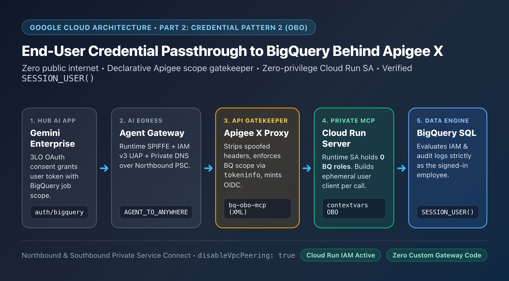
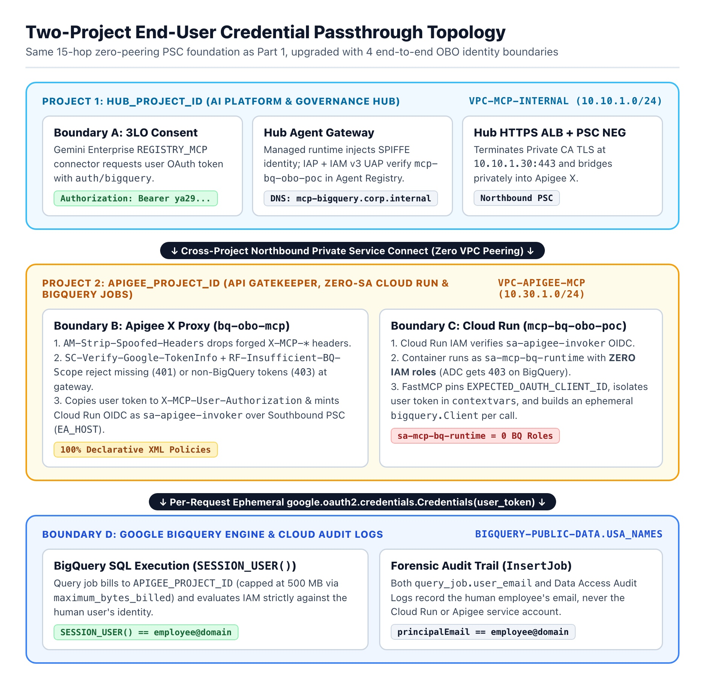
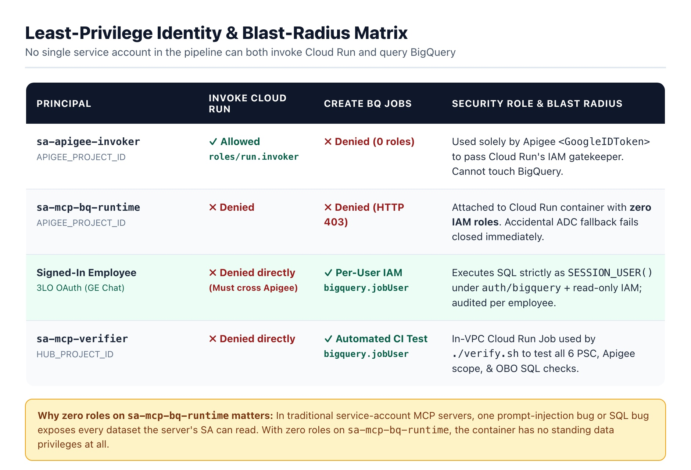
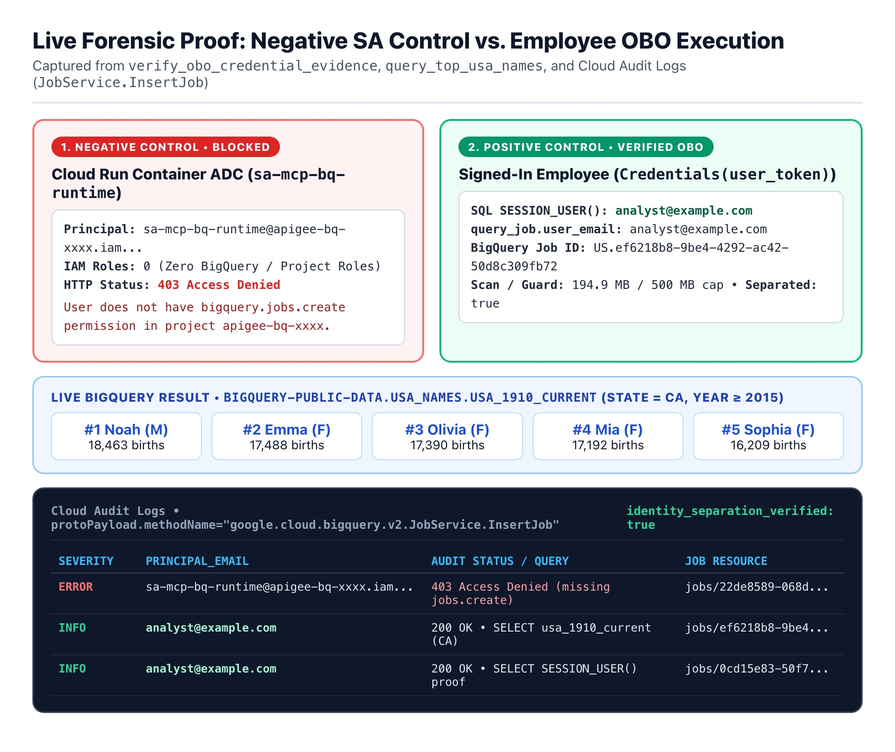

# Pattern 2: End-User Credential Passthrough (OBO) to BigQuery Behind Apigee X + Dual PSC + Gemini Enterprise



Standalone reference implementation and automation suite for **Enterprise MCP Credential Pattern 2 (On-Behalf-Of / End-User Credential Passthrough)**. This directory builds on [Part 1 (`blog_ge_apigee_mcp` root)](../README.md) while keeping 100% of Part 1's scripts and assets untouched, standing up two dedicated Google Cloud projects from scratch so **Gemini Enterprise** queries **Google BigQuery** (`bigquery-public-data.usa_names.usa_1910_current`) **strictly under the signed-in employee's 3LO Google OAuth 2.0 credential (`SESSION_USER()`)** across **Agent Gateway**, **Northbound & Southbound Private Service Connect (PSC)**, and **Apigee X**.

---

## End-to-End OBO Architecture



### What Changes in Pattern 2 vs. Pattern 1
- **Scoped 3LO OAuth (`auth/bigquery`) + IAM Read-Only Enforcement:** Gemini Enterprise requests `openid email profile https://www.googleapis.com/auth/bigquery` during per-user 3LO consent (required by BigQuery's `jobs.insert` API even for `SELECT` queries, while Cloud IAM `roles/bigquery.jobUser` without `dataEditor` enforces read-only SQL execution).
- **Declarative Apigee X Scope & Header Gatekeeper (Zero Custom Code):** The `bq-obo-mcp` proxy strips forged `X-MCP-*` headers (`AM-Strip-Spoofed-Headers`), introspects tokens via `SC-Verify-Google-TokenInfo`, blocks under-scoped tokens (`userinfo.email` or `bigquery.readonly`) right at the gateway (`HTTP 403 insufficient_scope`), forwards the verified user token in `X-MCP-User-Authorization`, and mints a Cloud Run OIDC ID token (`<GoogleIDToken>`) as `sa-apigee-invoker`.
- **Zero-Privilege Cloud Run Service Account (`sa-mcp-bq-runtime`):** The Cloud Run MCP server runs with `--no-allow-unauthenticated`, `--ingress=internal-and-cloud-load-balancing`, and **zero IAM roles on any project**. Attempting a BigQuery query with the container's own Application Default Credentials fails immediately with `HTTP 403 Access Denied`.
- **Per-Request Async Token Isolation & Forensic Proof:** FastMCP stores the raw user token inside a request-scoped `contextvars.ContextVar` (reset in `finally`), instantiates a short-lived `bigquery.Client(credentials=Credentials(token=user_token))` per call with a 500 MB `maximum_bytes_billed` cap, and returns `SELECT SESSION_USER()`, `query_job.user_email`, and `job_id` matching Cloud Audit Logs (`JobService.InsertJob`).



---

## Quickstart: Choose Your Deployment Path

### Prerequisites
- `gcloud` (500.0.0+), `curl`, `jq`, `openssl`, `zip`, and `python3` installed (or run in Google Cloud Shell).
- Active Google Cloud billing account + **Owner/Editor-equivalent permissions** in your organization (**Project Creator**, **Billing Account User**, and **Organization Policy Administrator**).

Clone the repository and enter `pattern2_obo`:

```bash
git clone https://github.com/caugusto/blog_ge_apigee_mcp.git
cd blog_ge_apigee_mcp/pattern2_obo
```

---

### Path A: Automated Provisioner from Blank Projects (`./deploy.sh`)

`./deploy.sh` creates two brand-new projects (`HUB_PROJECT_ID` and `APIGEE_PROJECT_ID`), links billing, enables all APIs including `bigquery.googleapis.com`, enforces zero IAM bindings on `sa-mcp-bq-runtime`, walks you through the 60-second Console step to create your Web OAuth 2.0 client (`*.apps.googleusercontent.com`), and detaches Stages 3 through 10 into `deploy.log` (~45-55 minutes end-to-end on blank projects):

```bash
chmod +x deploy.sh verify.sh teardown.sh
./deploy.sh
tail -f deploy.log
# Optional flags: --foreground | --reconfigure | --rebuild-mcp | --redeploy-proxy | --rebuild-verifier
```

Re-run the 6-check verification suite anytime:

```bash
./verify.sh
```



---

### Path B: Step-by-Step Manual CLI Deployment

To run and inspect each `gcloud`, `openssl`, and `curl` command manually across all nine phases, follow **[`docs/MANUAL_DEPLOYMENT_GUIDE.md`](./docs/MANUAL_DEPLOYMENT_GUIDE.md)**.

---

## Teardown / Cost Control

Delete the Apigee `EVALUATION` organization and both Google Cloud projects in one command when finished (or pass `--keep-projects` to keep empty project shells):

```bash
./teardown.sh
# Optional: ./teardown.sh --keep-projects
```

---

## Directory Structure (`pattern2_obo/`)

```text
pattern2_obo/
├── deploy.sh                         # Path A: Interactive, idempotent OBO provisioner
├── verify.sh                         # Public 404 check + 6-step in-VPC OBO verifier + Audit Log cmd
├── teardown.sh                       # Clean removal of evaluation resources (or full projects)
├── .env.example                      # Optional pre-filled configuration template
├── docs/
│   └── MANUAL_DEPLOYMENT_GUIDE.md    # Path B: Complete 9-phase manual CLI guide
├── mcp_bq_obo_server/                # FastMCP BigQuery OBO server (contextvars + 0-role SA)
├── apigee_bundles/bq-obo-mcp/        # Declarative Apigee X proxy (Anti-spoof + Scope check + OIDC)
├── cfg/toolspec_bq_obo.json          # Agent Registry MCP ToolSpec
├── verifier_job/                     # 6-check in-VPC Cloud Run verification job
└── images/                           # Retina architecture, sequence, IAM matrix, and audit diagrams
```
