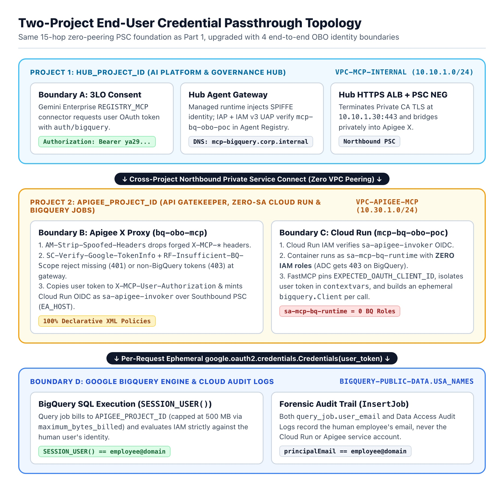

# Manual Step-by-Step Deployment Guide (Path B: Pattern 2 BigQuery OBO)

This guide walks through provisioning the two-project **End-User Credential Passthrough (OBO) to BigQuery Behind Apigee X + Dual Private Service Connect + Agent Gateway + Gemini Enterprise** architecture manually from the command line.

> **Prefer one-command automation?** Return to [`pattern2_obo/README.md`](../README.md) and run `./deploy.sh` (**Path A**), which automates every step below from blank Google Cloud projects with detached background logging (`deploy.log`) and `[SKIP]` resume.

---

## Architecture Reference



---

## Prerequisites

- **CLI tools:** `gcloud` (500.0.0+), `curl`, `jq`, `openssl`, `zip`, and `python3`.
- **Google Cloud permissions:** Project Creator, Billing Account User, and Organization Policy Administrator (or Owner-equivalent access on two blank projects).
- Run all commands below from inside `blog_ge_apigee_mcp/pattern2_obo/`.

---

## Phase 1: Create projects, link billing, enable APIs, and configure zero-SA IAM

```bash
gcloud auth login
gcloud auth application-default login

export BILLING_ACCOUNT_ID="PASTE_YOUR_BILLING_ACCOUNT_ID"
export HUB_PROJECT_ID="ge-bq-hub-$(date +%s | tail -c 5)"
export APIGEE_PROJECT_ID="apigee-bq-$(date +%s | tail -c 5)"
export REGION="us-central1"
export GE_LOCATION="global"
export GE_APP_ID="ge-apigee-bq-obo-app"
export COMPANY_NAME="Enterprise AI"

export BQ_MCP_HOST="mcp-bigquery.corp.internal"
export BQ_MCP_URL="https://${BQ_MCP_HOST}/mcp"
export HUB_APIGEE_ILB_IP="10.10.1.30"
export SB_ILB_IP="10.30.1.10"

get_token() {
  gcloud auth print-access-token 2>/dev/null
}

mkdir -p certs cfg

for PROJ in "${HUB_PROJECT_ID}" "${APIGEE_PROJECT_ID}"; do
  gcloud projects create "${PROJ}"
  gcloud billing projects link "${PROJ}" --billing-account="${BILLING_ACCOUNT_ID}"
done

export HUB_PROJECT_NUMBER=$(gcloud projects describe "${HUB_PROJECT_ID}" --format="value(projectNumber)")
export APIGEE_PROJECT_NUMBER=$(gcloud projects describe "${APIGEE_PROJECT_ID}" --format="value(projectNumber)")
export ORG_ID=$(gcloud projects get-ancestors "${HUB_PROJECT_ID}" --format=json | jq -r '[.[] | select(.type=="organization") | .id][0] // empty')

if [[ -n "${ORG_ID}" ]]; then
  export TRUST_DOMAIN="agents.global.org-${ORG_ID}.system.id.goog"
else
  export TRUST_DOMAIN="agents.global.proj-${HUB_PROJECT_NUMBER}.system.id.goog"
fi
```

Enable APIs across both projects (including `bigquery.googleapis.com` in `APIGEE_PROJECT_ID`), relax custom MCP org policies on `HUB_PROJECT_ID` if enforced, and create the service accounts while keeping `sa-mcp-bq-runtime` at **zero IAM roles**:

```bash
gcloud services enable \
  serviceusage.googleapis.com cloudresourcemanager.googleapis.com \
  discoveryengine.googleapis.com networkservices.googleapis.com \
  networksecurity.googleapis.com serviceextensions.googleapis.com \
  iap.googleapis.com agentregistry.googleapis.com \
  agentidentity.googleapis.com agentidentitycredentials.googleapis.com \
  aiplatform.googleapis.com compute.googleapis.com \
  --project="${HUB_PROJECT_ID}"

gcloud services enable \
  dns.googleapis.com certificatemanager.googleapis.com \
  run.googleapis.com cloudbuild.googleapis.com \
  artifactregistry.googleapis.com storage.googleapis.com \
  orgpolicy.googleapis.com iam.googleapis.com \
  iamcredentials.googleapis.com logging.googleapis.com \
  --project="${HUB_PROJECT_ID}"

if [[ -n "${ORG_ID}" ]]; then
  sleep 15
  for CONSTRAINT in \
    discoveryengine.managed.disableCustomMcpServerConnector \
    iam.managed.disableAccessPolicyBinding; do
    cat > "cfg/policy_${CONSTRAINT}.yaml" <<EOF
name: projects/${HUB_PROJECT_NUMBER}/policies/${CONSTRAINT}
spec:
  rules:
  - enforce: false
EOF
    for _ in {1..6}; do
      gcloud org-policies set-policy "cfg/policy_${CONSTRAINT}.yaml" --project="${HUB_PROJECT_ID}" && break
      sleep 10
    done
  done
fi

gcloud services enable \
  serviceusage.googleapis.com cloudresourcemanager.googleapis.com \
  apigee.googleapis.com bigquery.googleapis.com compute.googleapis.com \
  run.googleapis.com cloudkms.googleapis.com cloudbuild.googleapis.com \
  artifactregistry.googleapis.com storage.googleapis.com \
  iam.googleapis.com iamcredentials.googleapis.com logging.googleapis.com \
  --project="${APIGEE_PROJECT_ID}"

for SVC in apigee.googleapis.com cloudkms.googleapis.com compute.googleapis.com cloudbuild.googleapis.com; do
  gcloud beta services identity create --service="${SVC}" --project="${APIGEE_PROJECT_ID}" || true
done

for SVC in networkservices.googleapis.com discoveryengine.googleapis.com compute.googleapis.com cloudbuild.googleapis.com; do
  gcloud beta services identity create --service="${SVC}" --project="${HUB_PROJECT_ID}" || true
done

for PAIR in "${HUB_PROJECT_ID}:${HUB_PROJECT_NUMBER}" "${APIGEE_PROJECT_ID}:${APIGEE_PROJECT_NUMBER}"; do
  IFS=":" read -r P_ID P_NUM <<< "${PAIR}"
  for ROLE in roles/storage.admin roles/artifactregistry.writer roles/logging.logWriter roles/cloudbuild.builds.builder; do
    gcloud projects add-iam-policy-binding "${P_ID}" \
      --member="serviceAccount:${P_NUM}-compute@developer.gserviceaccount.com" \
      --role="${ROLE}" --condition=None --quiet
  done
done

# Create service accounts (NOTE: sa-mcp-bq-runtime intentionally receives ZERO IAM roles)
gcloud iam service-accounts create sa-mcp-bq-runtime \
  --display-name="Zero-Privilege BigQuery OBO MCP Runtime SA" \
  --project="${APIGEE_PROJECT_ID}"

gcloud iam service-accounts create sa-apigee-invoker \
  --display-name="Apigee X Southbound Cloud Run Invoker SA" \
  --project="${APIGEE_PROJECT_ID}"

gcloud iam service-accounts create sa-mcp-verifier \
  --display-name="In-VPC BigQuery OBO Verifier SA" \
  --project="${HUB_PROJECT_ID}"

sleep 10

# Grant roles/bigquery.jobUser to your human user and the automated in-VPC verifier SA
ACTIVE_USER=$(gcloud config get-value account)
gcloud projects add-iam-policy-binding "${APIGEE_PROJECT_ID}" \
  --member="user:${ACTIVE_USER}" \
  --role="roles/bigquery.jobUser" --condition=None --quiet

gcloud projects add-iam-policy-binding "${APIGEE_PROJECT_ID}" \
  --member="serviceAccount:sa-mcp-verifier@${HUB_PROJECT_ID}.iam.gserviceaccount.com" \
  --role="roles/bigquery.jobUser" --condition=None --quiet

export APIGEE_SERVICE_AGENT="service-${APIGEE_PROJECT_NUMBER}@gcp-sa-apigee.iam.gserviceaccount.com"
for ROLE in roles/iam.serviceAccountUser roles/iam.serviceAccountTokenCreator; do
  gcloud iam service-accounts add-iam-policy-binding \
    "sa-apigee-invoker@${APIGEE_PROJECT_ID}.iam.gserviceaccount.com" \
    --member="serviceAccount:${APIGEE_SERVICE_AGENT}" \
    --role="${ROLE}" --project="${APIGEE_PROJECT_ID}"
done
```

---

## Phase 2: Create the Web OAuth 2.0 Client in Google Auth Platform

1. Open `https://console.cloud.google.com/auth/clients?project=${HUB_PROJECT_ID}`.
2. If prompted on a new project, click **Get started**, set Audience to **Internal**, enter support/contact emails, and click **Create**.
3. Open **Clients** -> **+ Create client** -> **Web application**.
4. Add Authorized redirect URI: `https://vertexaisearch.cloud.google.com/oauth-redirect` and click **Create**.
5. Export the Client ID and Client Secret in your shell:

```bash
export OAUTH_CLIENT_ID="PASTE_CLIENT_ID.apps.googleusercontent.com"
export OAUTH_CLIENT_SECRET="PASTE_CLIENT_SECRET"
```

---

## Phase 3: Configure Cloud Identity, trial license, and Gemini Enterprise app

```bash
curl -s -X PATCH \
  "https://${GE_LOCATION}-discoveryengine.googleapis.com/v1alpha/projects/${HUB_PROJECT_ID}/locations/${GE_LOCATION}/aclConfig" \
  -H "Authorization: Bearer $(get_token)" \
  -H "X-Goog-User-Project: ${HUB_PROJECT_ID}" \
  -H "Content-Type: application/json" \
  -d "{\"name\": \"projects/${HUB_PROJECT_ID}/locations/${GE_LOCATION}/aclConfig\", \"idpConfig\": {\"idpType\": \"GSUITE\"}}"

read -r YEAR MONTH DAY <<< "$(python3 -c 'from datetime import datetime, timezone, timedelta; d = datetime.now(timezone.utc) + timedelta(days=1); print(d.year, d.month, d.day)')"

curl -s -X POST \
  "https://${GE_LOCATION}-discoveryengine.googleapis.com/v1alpha/projects/${HUB_PROJECT_ID}/locations/${GE_LOCATION}/licenseConfigs?licenseConfigId=free_trial_gemini" \
  -H "Authorization: Bearer $(get_token)" \
  -H "X-Goog-User-Project: ${HUB_PROJECT_ID}" \
  -H "Content-Type: application/json" \
  -d "{
    \"licenseCount\": \"50\",
    \"subscriptionTier\": \"SUBSCRIPTION_TIER_SEARCH_AND_ASSISTANT\",
    \"startDate\": {\"year\": ${YEAR}, \"month\": ${MONTH}, \"day\": ${DAY}},
    \"subscriptionTerm\": \"SUBSCRIPTION_TERM_ONE_MONTH\",
    \"freeTrial\": true
  }"

curl -s -X POST \
  "https://${GE_LOCATION}-discoveryengine.googleapis.com/v1alpha/projects/${HUB_PROJECT_NUMBER}/locations/${GE_LOCATION}/collections/default_collection/dataStores?dataStoreId=ge-init-store" \
  -H "Authorization: Bearer $(get_token)" \
  -H "X-Goog-User-Project: ${HUB_PROJECT_ID}" \
  -H "Content-Type: application/json" \
  -d '{"displayName": "Gemini Enterprise Initial Store", "industryVertical": "GENERIC", "solutionTypes": ["SOLUTION_TYPE_SEARCH"], "contentConfig": "CONTENT_REQUIRED"}'

sleep 10

curl -s -X POST \
  "https://${GE_LOCATION}-discoveryengine.googleapis.com/v1alpha/projects/${HUB_PROJECT_NUMBER}/locations/${GE_LOCATION}/collections/default_collection/engines?engineId=${GE_APP_ID}" \
  -H "Authorization: Bearer $(get_token)" \
  -H "X-Goog-User-Project: ${HUB_PROJECT_ID}" \
  -H "Content-Type: application/json" \
  -d "{
    \"displayName\": \"${GE_APP_ID}\",
    \"solutionType\": \"SOLUTION_TYPE_SEARCH\",
    \"industryVertical\": \"GENERIC\",
    \"appType\": \"APP_TYPE_INTRANET\",
    \"searchEngineConfig\": {\"searchTier\": \"SEARCH_TIER_ENTERPRISE\", \"searchAddOns\": [\"SEARCH_ADD_ON_LLM\"]},
    \"commonConfig\": {\"companyName\": \"${COMPANY_NAME}\"},
    \"dataStoreIds\": [\"ge-init-store\"]
  }"
```

---

## Phase 4: Provision Private Root CA, Hub VPC, Private DNS, and Agent Gateway

```bash
openssl req -x509 -newkey rsa:2048 -nodes -days 3650 \
  -keyout certs/ca.key -out certs/ca.crt \
  -subj "/O=Enterprise Internal PKI/CN=MCP Internal Root CA" \
  -addext "basicConstraints=critical,CA:TRUE" \
  -addext "keyUsage=critical,keyCertSign,cRLSign"

gcloud certificate-manager trust-configs create tc-mcp-corp-internal \
  --location="${REGION}" \
  --trust-store="trust-anchors=certs/ca.crt" \
  --project="${HUB_PROJECT_ID}"

gcloud compute networks create vpc-mcp-internal --subnet-mode=custom --project="${HUB_PROJECT_ID}"

gcloud compute networks subnets create subnet-ilb-backend \
  --network=vpc-mcp-internal --region="${REGION}" --range=10.10.1.0/24 \
  --enable-private-ip-google-access --project="${HUB_PROJECT_ID}"

gcloud compute networks subnets create subnet-ilb-proxy \
  --network=vpc-mcp-internal --region="${REGION}" --range=10.10.2.0/24 \
  --purpose=REGIONAL_MANAGED_PROXY --role=ACTIVE --project="${HUB_PROJECT_ID}"

gcloud compute networks subnets create subnet-agw-psc \
  --network=vpc-mcp-internal --region="${REGION}" --range=10.10.3.0/28 \
  --enable-private-ip-google-access --project="${HUB_PROJECT_ID}"

gcloud compute network-attachments create na-agw-mcp-internal \
  --region="${REGION}" --subnets=subnet-agw-psc \
  --connection-preference=ACCEPT_AUTOMATIC --project="${HUB_PROJECT_ID}"

gcloud dns managed-zones create zone-corp-internal \
  --dns-name="corp.internal." --description="Private DNS zone for internal MCP services" \
  --visibility=private --networks=vpc-mcp-internal --project="${HUB_PROJECT_ID}"

export AGW_SA="service-${HUB_PROJECT_NUMBER}@gcp-sa-agentgateway.iam.gserviceaccount.com"
for ROLE in roles/agentgateway.serviceAgent roles/compute.networkViewer roles/compute.networkAdmin roles/dns.reader roles/certificatemanager.viewer; do
  gcloud projects add-iam-policy-binding "${HUB_PROJECT_ID}" \
    --member="serviceAccount:${AGW_SA}" --role="${ROLE}" --condition=None --quiet
done

sleep 60

export PSC_NA_URI="projects/${HUB_PROJECT_NUMBER}/regions/${REGION}/networkAttachments/na-agw-mcp-internal"
export TRUST_CONFIG_URI="projects/${HUB_PROJECT_NUMBER}/locations/${REGION}/trustConfigs/tc-mcp-corp-internal"
export ACT_URI="projects/${HUB_PROJECT_NUMBER}/locations/${REGION}/agentConnectivityTemplates/act-vpc-mcp-internal"
export AGW_NAME="agw-vpc-${REGION}-ata"
export AGW_URI="projects/${HUB_PROJECT_ID}/locations/${REGION}/agentGateways/${AGW_NAME}"

curl -s -X POST \
  "https://networkservices.googleapis.com/v1/projects/${HUB_PROJECT_ID}/locations/${REGION}/agentConnectivityTemplates?agentConnectivityTemplateId=act-vpc-mcp-internal" \
  -H "Authorization: Bearer $(get_token)" \
  -H "X-Goog-User-Project: ${HUB_PROJECT_ID}" \
  -H "Content-Type: application/json" \
  -d "{
    \"accessPath\": \"AGENT_TO_ANYWHERE\",
    \"deploymentModel\": \"CENTRALIZED\",
    \"egressNetworkConfig\": {
      \"networkAttachment\": \"${PSC_NA_URI}\",
      \"dnsPeeringConfig\": {\"domains\": [\"corp.internal.\"], \"targetNetwork\": \"projects/${HUB_PROJECT_ID}/global/networks/vpc-mcp-internal\"},
      \"vpcEgress\": \"PRIVATE_RANGES_ONLY\",
      \"tlsConfig\": {\"trustConfig\": \"${TRUST_CONFIG_URI}\", \"additionalRoots\": \"PUBLICLY_TRUSTED_ROOTS\"}
    }
  }"

sleep 30

curl -s -X POST \
  "https://networkservices.googleapis.com/v1/projects/${HUB_PROJECT_ID}/locations/${REGION}/agentGateways?agentGatewayId=${AGW_NAME}" \
  -H "Authorization: Bearer $(get_token)" \
  -H "X-Goog-User-Project: ${HUB_PROJECT_ID}" \
  -H "Content-Type: application/json" \
  -d "{
    \"protocols\": [\"MCP\"],
    \"googleManaged\": {\"governedAccessPath\": \"AGENT_TO_ANYWHERE\"},
    \"agentConnectivityTemplate\": \"${ACT_URI}\",
    \"registries\": [\"//agentregistry.googleapis.com/projects/${HUB_PROJECT_ID}/locations/${REGION}\"]
  }"

sleep 60

cat > cfg/iap-authz-ext.yaml <<EOF
name: agw-authz-ext-iap-v2
service: iap.googleapis.com
failOpen: false
timeout: 1s
metadata:
  iapPolicyVersion: "V2"
EOF

gcloud service-extensions authz-extensions import agw-authz-ext-iap-v2 \
  --source=cfg/iap-authz-ext.yaml --location="${REGION}" --project="${HUB_PROJECT_ID}"

curl -s -X POST \
  "https://networksecurity.googleapis.com/v1alpha1/projects/${HUB_PROJECT_ID}/locations/${REGION}/authzPolicies?authz_policy_id=${AGW_NAME}-authz-policy-iap" \
  -H "Authorization: Bearer $(get_token)" \
  -H "X-Goog-User-Project: ${HUB_PROJECT_ID}" \
  -H "Content-Type: application/json" \
  -d "{
    \"name\": \"${AGW_NAME}-authz-policy-iap\",
    \"policyProfile\": \"REQUEST_AUTHZ\",
    \"action\": \"CUSTOM\",
    \"target\": {\"resources\": [\"${AGW_URI}\"]},
    \"customProvider\": {\"authzExtension\": {\"resources\": [\"projects/${HUB_PROJECT_ID}/locations/${REGION}/authzExtensions/agw-authz-ext-iap-v2\"]}}
  }"

curl -s -X POST \
  "https://iam.googleapis.com/v3/projects/${HUB_PROJECT_ID}/locations/global/accessPolicies?accessPolicyId=agent-gateway-allow-policy" \
  -H "Authorization: Bearer $(get_token)" \
  -H "X-Goog-User-Project: ${HUB_PROJECT_ID}" \
  -H "Content-Type: application/json" \
  -d "{
    \"details\": {
      \"rules\": [{
        \"effect\": \"ALLOW\",
        \"principals\": [\"principalSet://${TRUST_DOMAIN}/*\"],
        \"operation\": {\"permissions\": [\"iap.googleapis.com/resources.egressViaIAP\"]},
        \"conditions\": {\"iap.googleapis.com\": {\"expression\": \"destination.unregistered.host.endsWith('googleapis.com') || destination.is_registered == true\"}}
      }]
    }
  }"

sleep 15

curl -s -X POST \
  "https://iam.googleapis.com/v3/projects/${HUB_PROJECT_ID}/locations/global/policyBindings?policyBindingId=agent-gateway-allow-binding" \
  -H "Authorization: Bearer $(get_token)" \
  -H "X-Goog-User-Project: ${HUB_PROJECT_ID}" \
  -H "Content-Type: application/json" \
  -d "{
    \"policyKind\": \"ACCESS\",
    \"policy\": \"projects/${HUB_PROJECT_ID}/locations/global/accessPolicies/agent-gateway-allow-policy\",
    \"target\": {\"resource\": \"//cloudresourcemanager.googleapis.com/projects/${HUB_PROJECT_ID}\"}
  }"

curl -s -X PATCH \
  "https://${GE_LOCATION}-discoveryengine.googleapis.com/v1/projects/${HUB_PROJECT_ID}/locations/${GE_LOCATION}/collections/default_collection/engines/${GE_APP_ID}?updateMask=agentGatewaySetting.defaultEgressAgentGateway.name" \
  -H "Authorization: Bearer $(get_token)" \
  -H "X-Goog-User-Project: ${HUB_PROJECT_ID}" \
  -H "Content-Type: application/json" \
  -d "{\"agentGatewaySetting\": {\"defaultEgressAgentGateway\": {\"name\": \"projects/${HUB_PROJECT_NUMBER}/locations/${REGION}/agentGateways/${AGW_NAME}\"}}}"
```

---

## Phase 5: Deploy the zero-privilege Cloud Run BigQuery OBO server

```bash
export VERIFIER_SA_EMAIL="sa-mcp-verifier@${HUB_PROJECT_ID}.iam.gserviceaccount.com"

gcloud run deploy mcp-bq-obo-poc \
  --source=mcp_bq_obo_server \
  --region="${REGION}" \
  --project="${APIGEE_PROJECT_ID}" \
  --service-account="sa-mcp-bq-runtime@${APIGEE_PROJECT_ID}.iam.gserviceaccount.com" \
  --ingress=internal-and-cloud-load-balancing \
  --no-allow-unauthenticated \
  --port=8080 \
  --min-instances=0 \
  --max-instances=5 \
  --set-env-vars="GOOGLE_CLOUD_PROJECT=${APIGEE_PROJECT_ID},BQ_JOB_PROJECT=${APIGEE_PROJECT_ID},EXPECTED_OAUTH_CLIENT_ID=${OAUTH_CLIENT_ID},ALLOWED_VERIFIER_EMAIL=${VERIFIER_SA_EMAIL}"

export CLOUD_RUN_URL=$(gcloud run services describe mcp-bq-obo-poc --region="${REGION}" --project="${APIGEE_PROJECT_ID}" --format="value(status.url)")

gcloud run services add-iam-policy-binding mcp-bq-obo-poc \
  --region="${REGION}" \
  --project="${APIGEE_PROJECT_ID}" \
  --member="serviceAccount:sa-apigee-invoker@${APIGEE_PROJECT_ID}.iam.gserviceaccount.com" \
  --role="roles/run.invoker"
```

---

## Phase 6: Provision Apigee X (`EVALUATION`, `disableVpcPeering: true`) and truststore

```bash
gcloud kms keyrings create "apigee-keyring-${REGION}" --location="${REGION}" --project="${APIGEE_PROJECT_ID}"
gcloud kms keys create apigee-disk-key --keyring="apigee-keyring-${REGION}" --location="${REGION}" --purpose=encryption --project="${APIGEE_PROJECT_ID}"

export KMS_KEY_ID="projects/${APIGEE_PROJECT_ID}/locations/${REGION}/keyRings/apigee-keyring-${REGION}/cryptoKeys/apigee-disk-key"

gcloud kms keys add-iam-policy-binding apigee-disk-key \
  --keyring="apigee-keyring-${REGION}" --location="${REGION}" \
  --member="serviceAccount:${APIGEE_SERVICE_AGENT}" \
  --role="roles/cloudkms.cryptoKeyEncrypterDecrypter" \
  --project="${APIGEE_PROJECT_ID}"

curl -s -X POST "https://apigee.googleapis.com/v1/organizations?parent=projects/${APIGEE_PROJECT_ID}" \
  -H "Authorization: Bearer $(get_token)" \
  -H "Content-Type: application/json" \
  -d "{
    \"name\": \"${APIGEE_PROJECT_ID}\",
    \"displayName\": \"Apigee X Internal BigQuery OBO Organization\",
    \"analyticsRegion\": \"${REGION}\",
    \"runtimeType\": \"CLOUD\",
    \"billingType\": \"EVALUATION\",
    \"disableVpcPeering\": true
  }"

# Wait until organization state == ACTIVE, then create environment, envgroup, and runtime instance (~20-25 min)
curl -s -X POST "https://apigee.googleapis.com/v1/organizations/${APIGEE_PROJECT_ID}/environments" \
  -H "Authorization: Bearer $(get_token)" -H "Content-Type: application/json" \
  -d '{"name": "eval-mcp", "deploymentType": "PROXY", "apiProxyType": "PROGRAMMABLE"}'

curl -s -X POST "https://apigee.googleapis.com/v1/organizations/${APIGEE_PROJECT_ID}/envgroups" \
  -H "Authorization: Bearer $(get_token)" -H "Content-Type: application/json" \
  -d "{\"name\": \"internal-mcp-group\", \"hostnames\": [\"${BQ_MCP_HOST}\"]}"

curl -s -X POST "https://apigee.googleapis.com/v1/organizations/${APIGEE_PROJECT_ID}/envgroups/internal-mcp-group/attachments" \
  -H "Authorization: Bearer $(get_token)" -H "Content-Type: application/json" \
  -d '{"environment": "eval-mcp"}'

curl -s -X POST "https://apigee.googleapis.com/v1/organizations/${APIGEE_PROJECT_ID}/instances" \
  -H "Authorization: Bearer $(get_token)" -H "Content-Type: application/json" \
  -d "{
    \"name\": \"apigee-${REGION}\",
    \"location\": \"${REGION}\",
    \"diskEncryptionKeyName\": \"${KMS_KEY_ID}\",
    \"consumerAcceptList\": [\"${HUB_PROJECT_ID}\", \"${APIGEE_PROJECT_ID}\"]
  }"

# Poll until runtime instance state == ACTIVE:
while [[ "$(curl -s -H "Authorization: Bearer $(get_token)" "https://apigee.googleapis.com/v1/organizations/${APIGEE_PROJECT_ID}/instances/apigee-${REGION}" | jq -r '.state')" != "ACTIVE" ]]; do
  echo "Waiting for Apigee runtime instance..."
  sleep 30
done

curl -s -X POST "https://apigee.googleapis.com/v1/organizations/${APIGEE_PROJECT_ID}/instances/apigee-${REGION}/attachments" \
  -H "Authorization: Bearer $(get_token)" -H "Content-Type: application/json" \
  -d '{"environment": "eval-mcp"}'

export APIGEE_NB_SERVICE_ATTACHMENT=$(curl -s -H "Authorization: Bearer $(get_token)" \
  "https://apigee.googleapis.com/v1/organizations/${APIGEE_PROJECT_ID}/instances/apigee-${REGION}" | jq -r '.serviceAttachment')

curl -s -X POST "https://apigee.googleapis.com/v1/organizations/${APIGEE_PROJECT_ID}/environments/eval-mcp/keystores" \
  -H "Authorization: Bearer $(get_token)" -H "Content-Type: application/json" \
  -d '{"name": "mcp-ca-truststore"}'

curl -s -X POST "https://apigee.googleapis.com/v1/organizations/${APIGEE_PROJECT_ID}/environments/eval-mcp/keystores/mcp-ca-truststore/aliases?alias=mcp-root-ca&format=keycertfile" \
  -H "Authorization: Bearer $(get_token)" -F "file=@certs/ca.crt"

curl -s -X POST "https://apigee.googleapis.com/v1/organizations/${APIGEE_PROJECT_ID}/environments/eval-mcp/references" \
  -H "Authorization: Bearer $(get_token)" -H "Content-Type: application/json" \
  -d '{"name": "mcp-ca-truststore-ref", "resourceType": "KeyStore", "refers": "mcp-ca-truststore"}'
```

---

## Phase 7: Provision Southbound PSC, Internal HTTPS ALB, and two-pass `EA_HOST` SAN cert

```bash
gcloud compute networks create vpc-apigee-mcp --subnet-mode=custom --project="${APIGEE_PROJECT_ID}"

gcloud compute networks subnets create subnet-apigee-mcp-backend \
  --network=vpc-apigee-mcp --region="${REGION}" --range=10.30.1.0/24 \
  --enable-private-ip-google-access --project="${APIGEE_PROJECT_ID}"

gcloud compute networks subnets create subnet-apigee-mcp-proxy \
  --network=vpc-apigee-mcp --region="${REGION}" --purpose=REGIONAL_MANAGED_PROXY \
  --role=ACTIVE --range=10.30.2.0/24 --project="${APIGEE_PROJECT_ID}"

gcloud compute networks subnets create subnet-apigee-mcp-psc-nat \
  --network=vpc-apigee-mcp --region="${REGION}" --purpose=PRIVATE_SERVICE_CONNECT \
  --range=10.30.3.0/24 --project="${APIGEE_PROJECT_ID}"

gcloud compute addresses create ip-ilb-mcp-bq-obo \
  --region="${REGION}" --subnet=subnet-apigee-mcp-backend \
  --addresses="${SB_ILB_IP}" --project="${APIGEE_PROJECT_ID}"

openssl genrsa -out certs/mcp-bq-sb.key 2048
cat > certs/bq-sb-init.cnf <<EOF
[req]
distinguished_name = dn
req_extensions = v3_req
prompt = no
[dn]
CN = ${BQ_MCP_HOST}
[v3_req]
basicConstraints = CA:FALSE
keyUsage = critical, digitalSignature, keyEncipherment
extendedKeyUsage = serverAuth
subjectAltName = DNS:${BQ_MCP_HOST},IP:${SB_ILB_IP},IP:${HUB_APIGEE_ILB_IP}
EOF

openssl req -new -key certs/mcp-bq-sb.key -out certs/mcp-bq-sb.csr -config certs/bq-sb-init.cnf
openssl x509 -req -in certs/mcp-bq-sb.csr -CA certs/ca.crt -CAkey certs/ca.key -CAcreateserial \
  -out certs/mcp-bq-sb-init.crt -days 825 -sha256 -extensions v3_req -extfile certs/bq-sb-init.cnf

gcloud compute ssl-certificates create cert-mcp-bq-sb-v1 \
  --certificate=certs/mcp-bq-sb-init.crt --private-key=certs/mcp-bq-sb.key \
  --region="${REGION}" --project="${APIGEE_PROJECT_ID}"

gcloud compute network-endpoint-groups create neg-mcp-bq-obo-poc \
  --region="${REGION}" --network-endpoint-type=serverless \
  --cloud-run-service=mcp-bq-obo-poc --project="${APIGEE_PROJECT_ID}"

gcloud compute backend-services create bs-mcp-bq-obo-poc \
  --load-balancing-scheme=INTERNAL_MANAGED --protocol=HTTP \
  --region="${REGION}" --project="${APIGEE_PROJECT_ID}"

gcloud compute backend-services add-backend bs-mcp-bq-obo-poc \
  --region="${REGION}" --network-endpoint-group=neg-mcp-bq-obo-poc \
  --network-endpoint-group-region="${REGION}" --project="${APIGEE_PROJECT_ID}"

gcloud compute url-maps create um-mcp-bq-obo-poc \
  --default-service=bs-mcp-bq-obo-poc --region="${REGION}" --project="${APIGEE_PROJECT_ID}"

gcloud compute target-https-proxies create tp-mcp-bq-obo-poc \
  --url-map=um-mcp-bq-obo-poc --ssl-certificates=cert-mcp-bq-sb-v1 \
  --region="${REGION}" --project="${APIGEE_PROJECT_ID}"

gcloud compute forwarding-rules create fr-mcp-bq-obo-poc \
  --load-balancing-scheme=INTERNAL_MANAGED --network=vpc-apigee-mcp \
  --subnet=subnet-apigee-mcp-backend --address=ip-ilb-mcp-bq-obo --ports=443 \
  --region="${REGION}" --target-https-proxy=tp-mcp-bq-obo-poc \
  --target-https-proxy-region="${REGION}" --project="${APIGEE_PROJECT_ID}"

gcloud compute service-attachments create sa-psc-mcp-bq-obo \
  --region="${REGION}" --producer-forwarding-rule=fr-mcp-bq-obo-poc \
  --connection-preference=ACCEPT_AUTOMATIC --nat-subnets=subnet-apigee-mcp-psc-nat \
  --project="${APIGEE_PROJECT_ID}"

curl -s -X POST \
  "https://apigee.googleapis.com/v1/organizations/${APIGEE_PROJECT_ID}/endpointAttachments?endpointAttachmentId=ea-mcp-bq-obo" \
  -H "Authorization: Bearer $(get_token)" -H "Content-Type: application/json" \
  -d "{\"location\": \"${REGION}\", \"serviceAttachment\": \"projects/${APIGEE_PROJECT_ID}/regions/${REGION}/serviceAttachments/sa-psc-mcp-bq-obo\"}"

while [[ "$(curl -s -H "Authorization: Bearer $(get_token)" "https://apigee.googleapis.com/v1/organizations/${APIGEE_PROJECT_ID}/endpointAttachments/ea-mcp-bq-obo" | jq -r '.state')" != "ACTIVE" ]]; do
  sleep 10
done

export EA_HOST=$(curl -s -H "Authorization: Bearer $(get_token)" \
  "https://apigee.googleapis.com/v1/organizations/${APIGEE_PROJECT_ID}/endpointAttachments/ea-mcp-bq-obo" | jq -r '.host')

cat > certs/bq-sb-ext.cnf <<EOF
[v3_req]
basicConstraints = CA:FALSE
keyUsage = critical, digitalSignature, keyEncipherment
extendedKeyUsage = serverAuth
subjectAltName = DNS:${BQ_MCP_HOST},IP:${SB_ILB_IP},IP:${HUB_APIGEE_ILB_IP},IP:${EA_HOST}
EOF

openssl x509 -req -in certs/mcp-bq-sb.csr -CA certs/ca.crt -CAkey certs/ca.key -CAcreateserial \
  -out certs/mcp-bq-sb.crt -days 825 -sha256 -extensions v3_req -extfile certs/bq-sb-ext.cnf

gcloud compute ssl-certificates create cert-mcp-bq-sb-v2 \
  --certificate=certs/mcp-bq-sb.crt --private-key=certs/mcp-bq-sb.key \
  --region="${REGION}" --project="${APIGEE_PROJECT_ID}"

gcloud compute target-https-proxies update tp-mcp-bq-obo-poc \
  --ssl-certificates=cert-mcp-bq-sb-v2 --region="${REGION}" --project="${APIGEE_PROJECT_ID}"
```

---

## Phase 8: Package & deploy the `bq-obo-mcp` Apigee X proxy and Northbound PSC + Agent Registry

```bash
sed \
  -e "s|__EA_HOST__|${EA_HOST}|g" \
  -e "s|__CLOUD_RUN_URL__|${CLOUD_RUN_URL}|g" \
  apigee_bundles/bq-obo-mcp/apiproxy/targets/default.xml.tmpl \
  > apigee_bundles/bq-obo-mcp/apiproxy/targets/default.xml

(cd apigee_bundles/bq-obo-mcp && zip -qr ../../bq-obo-mcp.zip apiproxy -x "*.tmpl" -x "*/.DS_Store")

REV=$(curl -s -X POST \
  "https://apigee.googleapis.com/v1/organizations/${APIGEE_PROJECT_ID}/apis?action=import&name=bq-obo-mcp" \
  -H "Authorization: Bearer $(get_token)" \
  -F "file=@bq-obo-mcp.zip" | jq -r '.revision')

curl -s -X POST \
  "https://apigee.googleapis.com/v1/organizations/${APIGEE_PROJECT_ID}/environments/eval-mcp/apis/bq-obo-mcp/revisions/${REV}/deployments?override=true&serviceAccount=sa-apigee-invoker@${APIGEE_PROJECT_ID}.iam.gserviceaccount.com" \
  -H "Authorization: Bearer $(get_token)"

gcloud compute addresses create ip-ilb-apigee-bq-obo \
  --region="${REGION}" --subnet=subnet-ilb-backend \
  --addresses="${HUB_APIGEE_ILB_IP}" --project="${HUB_PROJECT_ID}"

openssl genrsa -out certs/mcp-bq.key 2048
cat > certs/bq-ext.cnf <<EOF
[req]
distinguished_name = dn
req_extensions = v3_req
prompt = no
[dn]
CN = ${BQ_MCP_HOST}
[v3_req]
basicConstraints = CA:FALSE
keyUsage = critical, digitalSignature, keyEncipherment
extendedKeyUsage = serverAuth
subjectAltName = DNS:${BQ_MCP_HOST},IP:${HUB_APIGEE_ILB_IP}
EOF

openssl req -new -key certs/mcp-bq.key -out certs/mcp-bq.csr -config certs/bq-ext.cnf
openssl x509 -req -in certs/mcp-bq.csr -CA certs/ca.crt -CAkey certs/ca.key -CAcreateserial \
  -out certs/mcp-bq.crt -days 825 -sha256 -extensions v3_req -extfile certs/bq-ext.cnf

gcloud compute ssl-certificates create cert-mcp-bq-hub \
  --certificate=certs/mcp-bq.crt --private-key=certs/mcp-bq.key \
  --region="${REGION}" --project="${HUB_PROJECT_ID}"

gcloud compute network-endpoint-groups create neg-psc-apigee-bq-obo \
  --network-endpoint-type=private-service-connect \
  --psc-target-service="${APIGEE_NB_SERVICE_ATTACHMENT}" \
  --network=vpc-mcp-internal --subnet=subnet-ilb-backend \
  --region="${REGION}" --project="${HUB_PROJECT_ID}"

gcloud compute backend-services create bs-apigee-bq-obo \
  --load-balancing-scheme=INTERNAL_MANAGED --protocol=HTTPS \
  --region="${REGION}" --project="${HUB_PROJECT_ID}"

gcloud compute backend-services add-backend bs-apigee-bq-obo \
  --network-endpoint-group=neg-psc-apigee-bq-obo \
  --network-endpoint-group-region="${REGION}" --region="${REGION}" --project="${HUB_PROJECT_ID}"

gcloud compute url-maps create um-apigee-bq-obo \
  --default-service=bs-apigee-bq-obo --region="${REGION}" --project="${HUB_PROJECT_ID}"

gcloud compute target-https-proxies create tp-apigee-bq-obo \
  --url-map=um-apigee-bq-obo --ssl-certificates=cert-mcp-bq-hub \
  --region="${REGION}" --project="${HUB_PROJECT_ID}"

gcloud compute forwarding-rules create fr-apigee-bq-obo \
  --load-balancing-scheme=INTERNAL_MANAGED --network=vpc-mcp-internal \
  --subnet=subnet-ilb-backend --address=ip-ilb-apigee-bq-obo --ports=443 \
  --region="${REGION}" --target-https-proxy=tp-apigee-bq-obo \
  --target-https-proxy-region="${REGION}" --project="${HUB_PROJECT_ID}"

gcloud dns record-sets create "${BQ_MCP_HOST}." \
  --zone=zone-corp-internal --type=A --ttl=60 \
  --rrdatas="${HUB_APIGEE_ILB_IP}" --project="${HUB_PROJECT_ID}"

TOOLSPEC_JSON=$(cat cfg/toolspec_bq_obo.json)
curl -s -X POST \
  "https://agentregistry.googleapis.com/v1/projects/${HUB_PROJECT_ID}/locations/${REGION}/services?serviceId=mcp-bq-obo-poc" \
  -H "Authorization: Bearer $(get_token)" \
  -H "X-Goog-User-Project: ${HUB_PROJECT_ID}" \
  -H "Content-Type: application/json" \
  -d "{
    \"displayName\": \"BigQuery OBO MCP Server (Apigee X + PSC + OAuth2)\",
    \"description\": \"Internal BigQuery End-User Credential Passthrough (Pattern 2) StreamableHTTP MCP server (${BQ_MCP_URL}).\",
    \"interfaces\": [{\"protocolBinding\": \"JSONRPC\", \"url\": \"${BQ_MCP_URL}\"}],
    \"mcpServerSpec\": {\"type\": \"TOOL_SPEC\", \"content\": ${TOOLSPEC_JSON}}
  }"

sleep 10

export MCP_BQ_REGISTRY_URI=$(curl -s \
  -H "Authorization: Bearer $(get_token)" \
  -H "X-Goog-User-Project: ${HUB_PROJECT_ID}" \
  "https://agentregistry.googleapis.com/v1alpha/projects/${HUB_PROJECT_ID}/locations/${REGION}/mcpServers" \
  | jq -r --arg url "${BQ_MCP_URL}" '.mcpServers[] | select(.interfaces[].url == $url) | .name')
```

---

## Phase 9: Connect Gemini Enterprise (`auth/bigquery`) and verify OBO execution

```bash
export COLLECTION_DISPLAY_NAME="mcp-bq-obo-apigee-collection"
export COLLECTION_ID="mcp-bq-obo-apigee-collection-$(date +%s)"
export OBO_SCOPES="openid email profile https://www.googleapis.com/auth/bigquery"
export OBO_INSTRUCTIONS="BIGQUERY OBO PASSTHROUGH MCP AGENT: Always invoke query_top_usa_names, verify_obo_credential_evidence, or get_authenticated_caller whenever asked about US baby names, state birth statistics, BigQuery public datasets, SESSION_USER(), end-user credential passthrough, Cloud Run service account permissions, or Apigee X scope enforcement."

curl -s -X POST \
  "https://${GE_LOCATION}-discoveryengine.googleapis.com/v1alpha/projects/${HUB_PROJECT_ID}/locations/${GE_LOCATION}:setUpDataConnector" \
  -H "Authorization: Bearer $(get_token)" \
  -H "X-Goog-User-Project: ${HUB_PROJECT_ID}" \
  -H "Content-Type: application/json" \
  -d "{
    \"collectionId\": \"${COLLECTION_ID}\",
    \"collectionDisplayName\": \"${COLLECTION_DISPLAY_NAME}\",
    \"dataConnector\": {
      \"dataSource\": \"custom_mcp\",
      \"dataSourceVersion\": 1,
      \"params\": {\"oauth_access_token\": \"unused\"},
      \"refreshInterval\": \"86400s\",
      \"entities\": [{\"entityName\": \"mcp_data\"}],
      \"connectorModes\": [\"FEDERATED\"],
      \"actionConfig\": {
        \"isActionConfigured\": true,
        \"createBapConnection\": true,
        \"actionParams\": {
          \"auth_type\": \"OAUTH\",
          \"instance_uri\": \"${BQ_MCP_URL}\",
          \"auth_uri\": \"https://accounts.google.com/o/oauth2/v2/auth\",
          \"auth_uri_params\": \"&access_type=offline&prompt=consent\",
          \"token_uri\": \"https://oauth2.googleapis.com/token\",
          \"client_id\": \"${OAUTH_CLIENT_ID}\",
          \"client_secret\": \"${OAUTH_CLIENT_SECRET}\",
          \"scopes\": \"${OBO_SCOPES}\",
          \"client_secret_basic_override\": true,
          \"mcp_server_source\": \"REGISTRY_MCP\",
          \"registry_mcp_server_name\": \"${MCP_BQ_REGISTRY_URI}\",
          \"mcp_agent_instructions\": \"${OBO_INSTRUCTIONS}\",
          \"use_agent_gateway_egress\": true,
          \"agent_gateway_engine\": \"projects/${HUB_PROJECT_ID}/locations/global/collections/default_collection/engines/${GE_APP_ID}\"
        }
      }
    }
  }"

# Run the automated 6-check verification suite:
./verify.sh

# Inspect BigQuery InsertJob Data Access Audit Logs to confirm principalEmail:
gcloud logging read \
  'protoPayload.serviceName="bigquery.googleapis.com" AND protoPayload.methodName="google.cloud.bigquery.v2.JobService.InsertJob"' \
  --project="${APIGEE_PROJECT_ID}" \
  --limit=5 \
  --format='table(timestamp,protoPayload.authenticationInfo.principalEmail,protoPayload.resourceName)'
```
